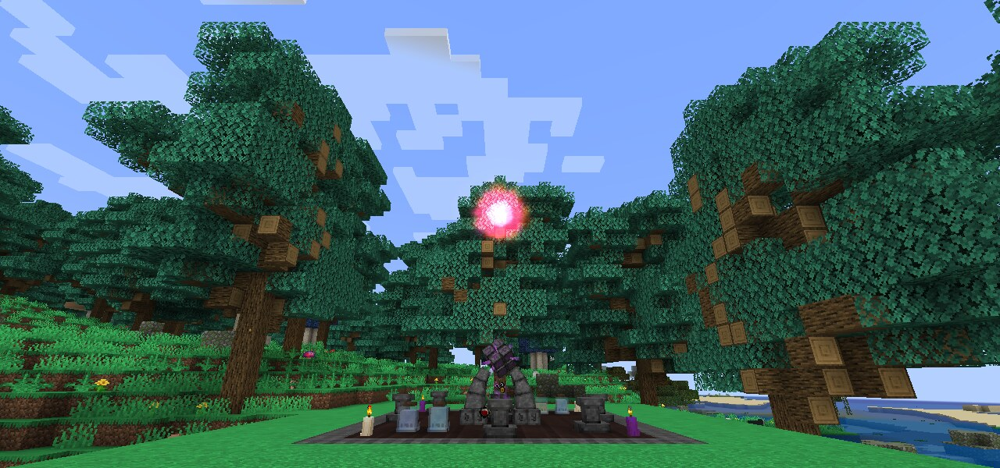
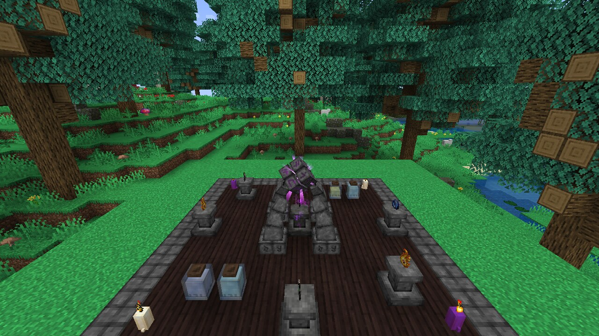
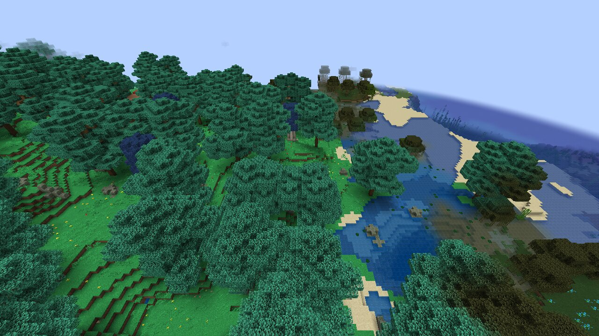
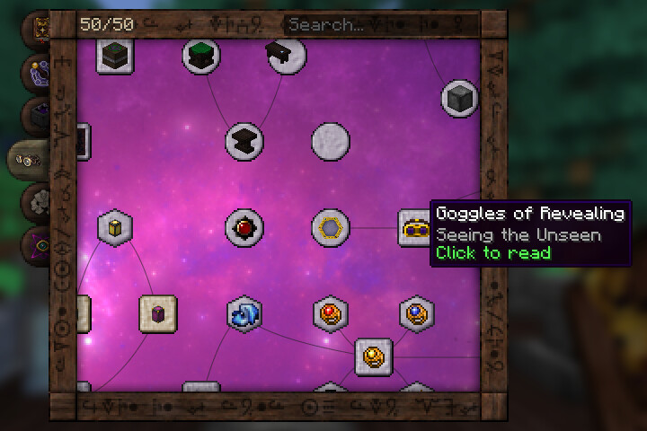
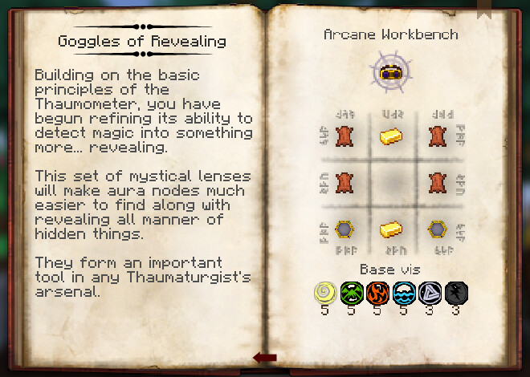
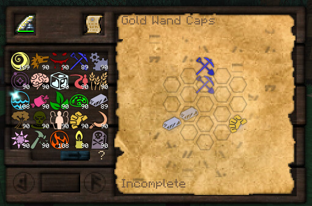
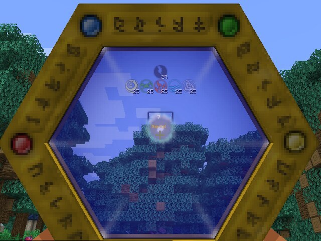

<div align="center">



# Thaumcraft 4 Reload

**Thaumcraft 4.2.3.5 от Azanor, перенесённый с Minecraft 1.7.10 на 1.21.1 — для Fabric и NeoForge.**

[](#установка)
[](#установка)
[](#установка)
[](#сборка-из-исходников)
[](#состояние-проекта)

[English](README.md) · **Русский**

</div>

---

Thaumcraft 4 Reload — неофициальный и максимально точный порт классического магического мода.
Спецификация — оригинальная версия 4.2.3.5: дерево исследований и его ключи, 48 аспектов и аспекты
предметов, рецепты, стоимость вис, поведение мобов и генерация мира повторяют мод для 1.7.10, вместе
с его особенностями. Там, где у 1.21.1 нет аналога (метаданные предметов, рудный словарь, Baubles),
порт переносит оригинал на современную игру и записывает каждое отклонение в
[`docs/audit/KNOWN_DEVIATIONS.md`](docs/audit/KNOWN_DEVIATIONS.md).

Сверху добавлено то, чего ждут от современной сборки: страницы рецептов в EMI и JEI, подсказки Jade,
экран настроек и необязательные улучшения, которые можно выключить и вернуть поведение 1.7.10.

## Скриншоты

<table>
  <tr>
    <td width="50%"></td>
    <td width="50%"></td>
  </tr>
  <tr>
    <td align="center"><sub>Магическое наполнение: пьедесталы, колонны и банки с эссенцией</sub></td>
    <td align="center"><sub>Магический лес с великими и серебряными деревьями</sub></td>
  </tr>
  <tr>
    <td></td>
    <td></td>
  </tr>
  <tr>
    <td align="center"><sub>Таумономикон с поиском и счётчиком изученного</sub></td>
    <td align="center"><sub>Страницы исследований с рецептами верстака, тигля и наполнения</sub></td>
  </tr>
  <tr>
    <td></td>
    <td></td>
  </tr>
  <tr>
    <td align="center"><sub>Решение заметок на столе исследований</sub></td>
    <td align="center"><sub>Сканирование узла ауры таумометром</sub></td>
  </tr>
</table>

## Что внутри

| | |
|---|---|
| **Исследования** | Таумономикон со всеми шестью разделами и 199 исследованиями, стол исследований и его головоломка, таумометр, открытие и сочетание аспектов, искажение и его события |
| **Тауматургия** | Жезлы, посохи и скипетры из всех стержней и колпачков, вис и скидки, набалдашники и их улучшения, набалдашниковый верстак, сумка для набалдашников |
| **Алхимия** | Тигель, эссенция, банки, трубы, клапаны и буферы, перегонные кубы, алхимическая печь, центрифуга, тауматорий, кристаллизаторы, зеркало для эссенции |
| **Изобретения** | Магический верстак, алтарь магического наполнения (инфузии) и его нестабильность, зачарование наполнением, рунические щиты, очки откровения, снаряжение путешественника, пояс парения, таумиевое и пустотное снаряжение, магический бур, лампы, зеркала, защита |
| **Големоведение** | Големы из всех материалов, ядра, улучшения, колокол голема и его метки |
| **Древние знания** | Внешние земли, древний портал и лабиринт, культисты, древние стражи, древний голем и древний хранитель |
| **Мир** | Узлы ауры и их экология, биомы «Магический лес», «Зловещий биом» и «Заражённые земли», порча и её существа, виспы, пехи, огненные летучие мыши, руды киновари и янтаря, сребролист, огненный жемчуг, магические бобы |
| **Аксессуары** | Встроены: амулет, два кольца и пояс. Открываются клавишей **B** или кнопкой рядом с персонажем; аксессуар в руке надевается правым кликом. Дополнительных модов не нужно |

Перенесено около 320 предметов, 160 блоков и 55 сущностей. Языки интерфейса: английский и русский.

## Удобства

Каждое улучшение — настройка в экране конфигурации (Mod Menu на Fabric, список модов на NeoForge),
по умолчанию включённая; выключенная, она возвращает правило оригинала.

- **Аспекты у каждого предмета.** Оригинальная таблица аспектов и её группы рудного словаря на
  предметах 1.21.1 и тегах `c:`, плюс вывод аспектов для предметов, которых не было в 1.7.10.
- **Таумономикон.** Поиск, счётчик изученного, закладки, управление с клавиатуры, возврат к открытой
  странице.
- **Идеи [TC4Tweaks](https://github.com/Glease/TC4Tweaks)**, реализованные заново: разнообразная
  добыча, земляной удар не уничтожает предметы, наполнение сохраняет чары и имя, полный флакон остаётся
  в руке, кнопка очистки уведомлений.
- **Просмотр рецептов.** Рецепты магического верстака, тигля, наполнения и зачарования наполнением, сочетания
  аспектов — в [EMI](https://modrinth.com/mod/emi) (с раскладкой в верстак) и
  [JEI](https://modrinth.com/mod/jei).
- **[Jade](https://modrinth.com/mod/jade).** Эссенция в банках, трубах и машинах в очках откровения,
  состояние печей, тигля и наполнения, ядро и улучшения голема.

## Установка

| | Fabric | NeoForge |
|---|---|---|
| Minecraft | 1.21.1 | 1.21.1 |
| Загрузчик | Fabric Loader 0.16.14 или новее | NeoForge 21.1 (собрано с 21.1.259) |
| Обязательно | [Fabric API](https://modrinth.com/mod/fabric-api), [Architectury API](https://modrinth.com/mod/architectury-api) 13.0.11+ | [Architectury API](https://modrinth.com/mod/architectury-api) 13.0.11+ |
| Необязательно | EMI, JEI, Jade, Mod Menu | EMI, JEI, Jade |
| Java | 21 | 21 |

Скачайте jar для своего загрузчика из [Releases](../../releases) и положите в `mods` вместе с
обязательными библиотеками. Начните **новый мир**: миры Thaumcraft 4 с 1.7.10 не конвертируются.

## Состояние проекта

Это **альфа**. Всё содержимое оригинала перенесено и проверяется автоматическими тестами, но долгих
прохождений на выживании многими игроками у порта ещё не было. Сообщайте о найденном.

На чём держится порт:

- каждый класс, рецепт, исследование и ресурс оригинала учтён в
  [`docs/porting/scope-ledger.json`](docs/porting/scope-ledger.json) (1044 из 1044 единиц с
  вердиктом и доказательством);
- около 2600 модульных тестов и около 480 игровых сценариев GameTest, почти все — на обоих
  загрузчиках;
- визуальные сверки с оригиналом в настоящем клиенте, кадры в [`docs/analysis`](docs/analysis).

Известные пробелы — в [`docs/audit/KNOWN_DEVIATIONS.md`](docs/audit/KNOWN_DEVIATIONS.md) §7; клиент
и мультиплеер NeoForge проверены меньше, чем Fabric.

## Сборка из исходников

```bash
./gradlew :common:test :fabric:build :neoforge:build
```

Jar-файлы появятся в `fabric/build/libs` и `neoforge/build/libs`. Наборам GameTest нужен свежий
тестовый мир:

```bash
rm -rf fabric/run-gametest/world && ./gradlew :fabric:runGameTest
rm -rf neoforge/run-gametest/world && ./gradlew :neoforge:runGameTest
```

`./gradlew :fabric:runClient -PwithEmi` (или `-PwithJei`, `-PwithJade`) запускает клиент разработки
с интеграцией. [`docs/HANDOFF.md`](docs/HANDOFF.md) описывает устройство проекта и состояние
каждой части порта.

## Вопросы

**Это официальный Thaumcraft?** Нет. Thaumcraft — мод Azanor; это фанатский порт его версии 4.2.3.5,
Azanor его не одобрял и не поддерживает.

**Нужны ли Baubles, Thaumic Tinkerer и другие аддоны?** Нет. Слоты аксессуаров встроены. Старые
аддоны для 1.7.10 на 1.21.1 не работают.

**Почему Thaumcraft 4, а не 6?** Четвёртую версию многие помнят лучше всего, и вокруг неё были
построены аддоны и сборки. Порт сохраняет её правила и не смешивает их с более поздними версиями.

## Авторы и лицензия

- **Thaumcraft** создал **Azanor**. Название, текстуры, звуки, модели и игровой дизайн — его работа.
- Порт: Andrey Bash и участники (см. [`LICENSE`](LICENSE)).
- Использованные источники, перенесённые алгоритмы и их лицензии перечислены в
  [`THIRD_PARTY_NOTICES.md`](THIRD_PARTY_NOTICES.md), среди них OpenTC4, Minecraft Forge 1.7.10 и
  идеи TC4Tweaks от Glease (код не копировался).

Лицензия MIT в [`LICENSE`](LICENSE) распространяется на собственную работу порта. Она не даёт прав
на оригинальные материалы Azanor и не перелицензирует их. Проект не связан с Azanor, Mojang Studios и
Microsoft.
