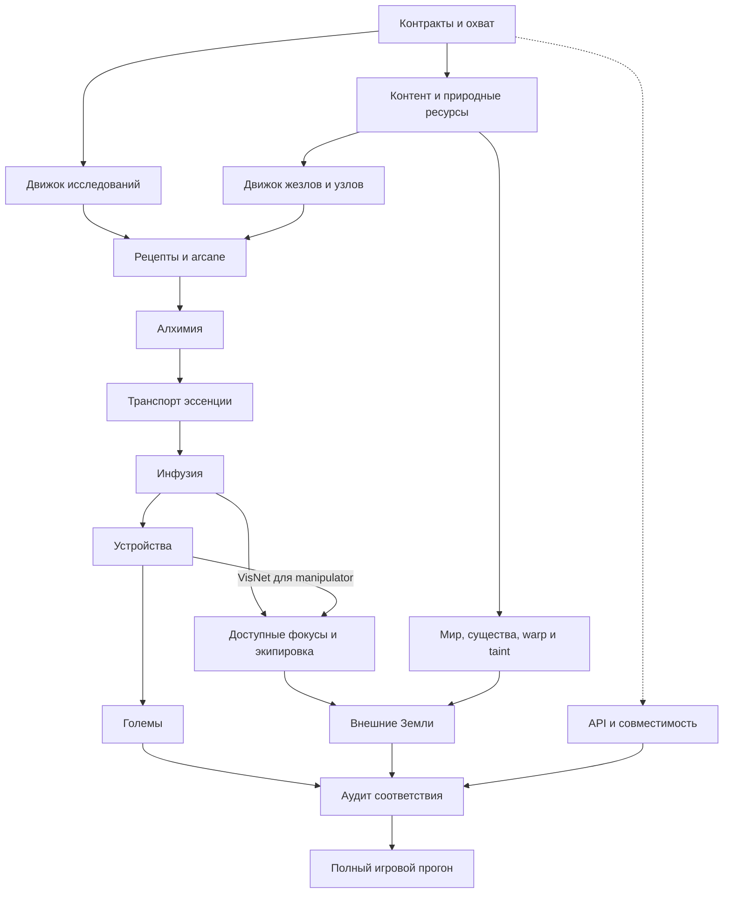

# План полного переноса Thaumcraft 4 на Minecraft 1.21.1

План пересмотрен 15–17.10.2026 по запросу пользователя; последний принятый игровой checkpoint — **`focal-fabric-validate7` / `focal-fabric-client14` (Fabric-only, манипулятор и bounded focus upgrades)**, ветка `port/minecraft-1.21.1`. Цель — полный игровой цикл **Thaumcraft 4.2.3.5** на **Minecraft 1.21.1, Java 21**, сначала **Fabric**, затем отдельная отложенная фаза **NeoForge**, с сохранением исходных значений, условий исследований и поведения. Этот документ задаёт будущие работы; выполненные проверки записываются отдельно в [статусе](MIGRATION_STATUS.md) и [verification.json](porting/verification.json).

## Текущая последовательность: Fabric → NeoForge

Пользователь16.10 изменил приоритет: **сначала весь игровой порт на Fabric**, затем
возвращаемся к NeoForge. Не развивать второй загрузчик и не запускать его сборки/
runtime проверки на каждом новом content checkpoint. Сохраняем common/Architectury
и уже сделанный NeoForge-модуль без удаления работы. Исторические двухзагрузочные
результаты ниже действительны только для своих исходников. Требования NeoForge в
дальнем плане — отложенная фаза, а не текущие gates Fabric-разработки.

Текущая цепь: basic tubes→инфузия→остальной TC4 контент, работающие сохранения,
интерфейсы/рендер и игровой прогресс **на Fabric**. Совместимость/упаковка/регрессии
NeoForge не должны блокировать эту очередь; ими занимаемся после завершения Fabric.

**Уточнение пользователя18.10:** прекратить развитие smoke-тестера, экспортировать
текущий бур предварительно, итоговые проверки перенести на конец общего переноса.
Следующая content-группа — голодный сундук и вход в големантию. Непринятые прогоны
бура не становятся принятыми; готовность механик и полнота проверки учитываются
раздельно. Дальнейший контент не блокируется новой инженерией аудитора.
Голодный сундук, семь обычных материалов големов, ядра Gather/Fill/Empty и их
контейнерные маршруты уже интегрированы и собраны на Fabric.
Directed world throws, Sorting10, Harvest3, Guard4 и Fishing11 тоже собраны;
Decanting5, Alchemy6, Butcher9, Use8 и материал Flesh тоже собраны (`golem-use-build1`).
Настоящий Axe of the Stream интегрирован и собран (`axe-stream-build1`, 302 JUnit),
игровой проход не выполнялся. Lumber7 с этим топором в рецепте инфузии тоже собран
(`lumber-build1`, 309 JUnit; `lumber-gametest1` 142/142 с первым GameTest реального голема).
Все 12 ядер оригинала интегрированы. Улучшения големов: контракт всех шести записан, первая группа
Air/Earth/Entropy собрана и проверена GameTest (`golem-upgrades-build2`, 332 JUnit; `golem-upgrades-gametest2` 143/143).
Вторая группа — вместимость Earth и радиус Water с предметом Water — тоже собрана и проверена (`golem-capacity-range-build2`, 339 JUnit; `golem-capacity-range-gametest2` 144/144; seen нет).
Третья группа — Fire и Order (поджог при ударе; пересадка Harvest) — собрана и проверена GameTest
(`fire-order-final-build` 346 JUnit; `fire-order-final-gametest` 145/145; seen нет). Все шесть типов улучшений поддержаны.
Четвёртая группа — слоты 6+6n, жарка улова Fishing и цвета маркеров/слотов Order — собрана и проверена GameTest
(`colors-final-build` 368 JUnit; `colors-final-gametest` 148/148; seen нет).
Пятая группа — переключатели целей Guard (Order; умолчание безопасное, отклонение от оригинала задокументировано) и улов Fishing (Order, Entropy, Air) — собрана и проверена GameTest
(`guard-fish-final-build` 384 JUnit; `guard-fish-final-gametest` 151/151; seen нет).
Шестая группа — продвинутый голем (+1 слот, ×1,1 скорости, +20 % радиуса, атака 18; патч-инфузия `ADVANCEDGOLEM`) — собрана и проверена GameTest
(393 JUnit; 153/153; seen нет). Следующая очередь M10 — декорации (контракт записан), остаток улучшений (нечёткое сравнение предметов и очередь Liquid у Entropy,
горящий предмет улова), Traveling Trunk и прочее; каждому нужен собственный контракт по оригиналу.
Это не полный M10; игровые/
визуальные проверки новых групп остаются отдельным pending до итогового прохода.

Проверки соразмерны изменению: routinecontent — целевой игровой сценарий, не
повтор всей12–15минутнойцепочки. Fullclientprogression оставлен для крупных общих
изменений и итоговых checkpoint; историческое получение сохранённых inputs не
выдаётся за повторённое в текущем focusedrun. Приняты equipment/caps/goggles и
три мантии/basicShock, [basic Excavation с native protected harvest](analysis/2026-10-16-excavation.md)
и [basic Frost с настоящим рикошетом](analysis/2026-10-16-frost.md).
Принят также [bounded M05 void jars/shared item interactions](analysis/2026-10-16-void-jars.md):
последний focusedclient7новыхкадров/4м1с, итог201JUnit/76Fabric/3682inputs.
Принят [M06a клапаны+резонатор+realshapelessarcane](analysis/2026-10-16-valves-resonator.md):
202JUnit/79Fabric/3694inputs/53Python,53сfocusedclient/7новыхосмотренныхкадров.
Принят [filters/restrict/oneway отдельный gate](analysis/2026-10-16-tube-filters.md):
203JUnit/82Fabric/3714inputs/56Python,112сfocusedclient/8новыхосмотренныхкадров.
Затем принят [buffer gate](analysis/2026-10-17-buffer-centrifuge.md):204JUnit/85Fabric/
3726inputs/58Python,78сfocusedclient/8осмотренныхкадров. Принят и экспортирован
[M06d construct/centrifuge](analysis/2026-10-17-centrifuge.md):204JUnit/88Fabric/
3742inputs/61Python,130сfocusedclient/8осмотренныхкадров. NeoForge не запускается.
Следом [кристаллизатор: source/dependency audit](analysis/2026-10-17-crystallizer-prep.md):
честный unassisted50с/unit baseline отдельно от EARTH/realVisNet acceleration;
always0powerstub не выдавать за полныйVisNet или закрытыйM09. Принят и экспортирован
[M06e bounded baseline](analysis/2026-10-17-crystallizer.md):210JUnit/92Fabric/
3767inputs/64Python/281сfocusedclient/8осмотренныхкадров. Принят и экспортирован
[M09a стабилизатор обычного узла](analysis/2026-10-17-stabilizer.md):211JUnit/
95Fabric/3782inputs/68Python/140сfocusedclient/8осмотренныхкадров, genuine1200tick
epoch. Это первая игровая часть [реальной VisNet closure](analysis/2026-10-17-visnet-prep.md),
не готовый energized source. Теперь принят и экспортирован [M09b](analysis/2026-10-17-visnet.md):
220JUnit/105Fabric/3827inputs/72Python,255сfocusedclient/10осмотренныхкадров,
1001/951native transitions,282rawEARTH/3×60+1×1000ticks, stoppedBASE80/count1091.
Нет always-zero stubs; fullspecialnodes/advancedstabilizer остаются позднее.
Следом принят и экспортирован [focal manipulator](analysis/2026-10-17-focal-manipulator.md):
238JUnit/113Fabric/3865inputs/74Python,10осмотренныхPNG и независимый stopped-save
аудит. Настоящие112XP/8LEVELS/2400rawCV/усиленный protected harvest, не заглушки.
Теперь начат Arcane Bore: original/source audit и pristine-tool infusion predicate
prerequisite. Вне bounded Frugal/Potency/Treasure/Enlarge остальные specializations
и пассивные эффекты Charm остаются pending, а не автоматически закрытым M08.
Buffer не является простойcapacity1variant. M08/upgrades/latefoci/FX/layout
gaps и полныеM05/M06 сохраняются.

## Границы полного переноса

- В объём входят все используемые оригиналом системы: исследования, предметы и блоки, рецепты, узлы и vis, алхимия и эссенция, инфузия, фокусы, устройства, големы, warp, существа, генерация мира, заражение, Внешние Земли, интерфейсы, графика, звуки, настройки и публичные расширения API.
- Полнота оценивается по работающему оригинальному контенту и сценариям. JSON-каталог, зарегистрированный предмет, заглушка или зелёная компиляция сами по себе систему не закрывают.
- TC4 4.2.3.5 — спецификация. Legacy FOREVA 1.12 и оба закреплённых OpenTC4 — вспомогательные источники. Механики TC5/TC6 не становятся частью цели из-за присутствия в legacy.
- Обязательны новые миры 1.21.1. Импорт миров, сохранений и конфигурации 1.7/1.12 — отдельный проект. Настройки генерации новых чанков в мире 1.21.1 рассматриваются отдельно от импорта старого мира.
- Расширяемый API переносится по контрактам TC4 с необходимой адаптацией типов Minecraft. Загрузка старых бинарных Forge-аддонов в современные loaders не входит в обещание совместимости.
- Разработка и Git остаются локальными. Публичная публикация — отдельное действие; текущая атрибуция и ограничения находятся в [THIRD_PARTY_NOTICES.md](../THIRD_PARTY_NOTICES.md).

Референсы закреплены в [source-lock](porting/source-lock.json): [OpenTC4](https://github.com/IgnoreLicensesCN/OpenTC4/tree/80aac29c52543ef51766c4b0788fba782abb3b0b) — изменённый 1.7.10 Forge источник с дополнительными API; [OpenTC4-Architectury](https://github.com/IgnoreLicensesCN/OpenTC4-Architectury/tree/1509b3192910aaca0af8bba1b55d189a675010bf) — незавершённый 1.20.1 Fabric/Forge порт. Оба используются адресно; NeoForge 1.21.1 интеграция реализуется в текущем проекте. Пины не обновляются автоматически при изменениях upstream.

## Отправная точка

Дополнение16.10 после R09/early-content: природные руды и обычные узлы,
объединение/bonus ecology, arcane workbench с двумя recipes и доступные book pages
имеют implementation evidence192JUnit/47+47server и Fabric26-scene run. Подробно
в MIGRATION_STATUS.md; ни один полный M00–M15 не закрыт. Следующая unit — M05тигель.

Продолжение16.10: M05тигель/первые10recipes/полезныеNitor+Alumentum/finiteflux
приняты implementation checkpoint197JUnit/51+51 и Fabric32captures, не полным M05.
Активна следующая цепочка: magical wood/filter→alchemy furnace→alembic→phials/jars,
arcane stone prerequisites и первые greatwood/gold wand upgrades. Результаты только
в MIGRATION_STATUS/HANDOFF; активные agents не считаются проверенным контентом.

Продолжение16.10: эта цепочка и greatwood/gold wand приняты checkpoint
`distillation-validate5`200JUnit/58+58 и `distillation-client5`40captures/root33–40.
Не закрывает full M02/M04/M05. Следующий bounded content — basic Fire Focus (M08,
использует M03/M04 engines) с настоящим equip/remove, vis/channel/projectile damage;
затем M07 инфузия с реальным reward,
не декоративным placeholder. Новые source changes проверять отдельно после freeze.

Продолжение16.10: basicFire +2plants приняты `fire-validate7`200JUnit/61+61 и
`fire-client5`46captures/root41–46; это не полный M08/visualparity. Следующая unit
M06basicTube/jarUPpull/quicksilverDROP, затемM07infusion. Дополнительные проекты
проверены read-only и pinned; [конкретная польза/ограничения](analysis/2026-10-16-user-reference-projects.md).

Продолжение16.10Fabric-first: basicTube/jarUPpull/quicksilverDROP приняты
`tubes-fabric-validate3`200JUnit/63Fabric/3458inputs и`client1`52captures/root47–52.
NeoForgepaused/notrun. Следующая boundedM07 unit — [originalinfusioncontract](analysis/2026-10-16-infusion-first-unit.md)
с настоящими63essentia/7components/instability5→Silverwood100vis, неI=0craft.

Продолжение16.10: перваяSTACKinfusion принята`infusion-fabric-validate7`200JUnit/
65Fabric/3521inputs и`infusion-fabric-client5`60captures/rootexact53–60. Actual
48shards→192essentia→63paid/7components→core→nativegoldassembly→100viswand/charge60.
Следом [9реальныхThaumiumequipmentitems](analysis/2026-10-16-thaumium-next-unit.md)
с исходнымиdamage/mining/armor/repair, без фиктивных innateabilities. Chargedcaps
следуют только приподтверждённом реальномauramsource; proposedbeaconraw+2 сначала
проверить черезfinalcull/nativeперегонку. Enchantment/прочиеинфузии отдельноpending.

Уже есть современная сборка обоих loaders, 48 аспектов, данные 201 исследования, знания и сохранение игрока, часть сканирования, обычный таумономикон, текстовые страницы, покупка Secondary при исходной обычной сложности, wood/iron wand, тестовый узел и базовые банка/фиалы. Крафтовые цепочки и естественное развитие ещё не завершены.

Последний принятый игровой checkpoint R06: **155 JUnit, 24 Python, 26 Fabric GameTests, 26 NeoForge GameTests**, сборки обоих loaders; настоящий Fabric client прошёл книгу/покупку/изучение и выдачу primary note, просмотрены14 снимков. Детали запусков и ограничения — в [статусе](MIGRATION_STATUS.md). Это результаты принятого checkpoint; они не подтверждают последующие незакоммиченные изменения стола.

На принятом R06 инвентарь содержал934 legacy Java units:23partial,911pending,0complete;61активный main Java. Текущий [class-inventory](porting/class-inventory.json) после native R08:34partial/900pending/0complete и75 main Java; scope связывает34 rows с53 native counterparts. Все1044 semantic verdicts остаются `needs_review`. Вынос A07 test helpers уменьшил main счётчик, не удаляя gameplay. Ни одно из этих чисел не является процентом готовности игры.

Сверка относительных Java paths выявила **749 общих путей, 185 legacy-only и 110 original-only** при 859 Java-файлах приватного oracle. Разница по пути может означать перенос класса, замену адаптером или лишний код. Поэтому нельзя ни автоматически переносить все 934 legacy-класса, ни забывать 110 original-only файлов.

Уже создан [scope ledger](porting/scope-ledger.json) на 1044 объединённых пути. Все семантические verdicts пока `needs_review`: инвентаризация файлов завершена для этих корпусов, построчная проверка всех реализаций ещё предстоит. M00 и M01 частичны; ни один полный этап M00–M15 пока не принят.

R06 закрывает выдачу первичной записки при default0, но не полный M01. R07 дал структуру/shared inventory/recovery/render. **Native R08 теперь подключён:** palette/place/erase/ink/pools/solver/discovery; Fabric GUI выполнил solve→take→learn, серверный сценарий проходит на обоих loaders. R09 ecology/combine и R10 copy остаются открытыми, как и NeoForge/packaged visual/full multiplayer/survival приёмка. Актуальное evidence — в MIGRATION_STATUS.md; таблица ниже описывает исторический R07.

| Evidence R07 | Фактический результат | Что ещё не подтверждено |
|---|---|---|
| `.tmp/r07-validate7.log` | Итоговая центральная проверка:161 JUnit и41+41 GameTests; XML без failures/errors/skips, обязательные case IDs присутствуют. Настоящие unload/reload, cold-load repair, ADD cancellation/retry, early wake, callback replacement и hidden UUID owner | Ordinary packaged client/server и полный gameplay |
| `.tmp/r07-assets3.log` |27 Python PASS; статические atlas sprites, native codecs и UV-проверка | Полное visual/audio parity всего мода |
| `.tmp/r07-client3.log`, [client evidence](porting/client-smoke-verification.json) | Fabric dev после финальных source changes:19 PNG просмотрены root,15–19 независимо; native place/conversion/menu/quick-move. Process restart client2→client3 сравнил весь Inventory NBT сохранённой пары до setup mutations | NeoForge table client, обычная packaged установка, research-item dropped и полный visual/audio audit |
| `RejectedEntitySpawn` и три accessor mixins | Подключены в очередь/config и исполнены на обоих loaders. Освобождается только новая reservation без visible/hidden owner; каждому rejected output задан transient cooldown не менее20 ticks | Общий аудит прочих native output paths будущих устройств |

Контракты и ограничения — в [R07 spec](analysis/2026-10-15-research-table-spec.md). История отказов сохранена: validate5 обнаружил UUID leak, validate6 подтвердил cleanup/hidden guard, но выявил ранний retry при новом enqueue. Validate7 проверяет оба исправления и явный early-wake regression; его PASS не выводится из предыдущих запусков.

## Порядок исполнения от текущего состояния

M00–M15 ниже определяют весь объём, а следующие волны задают рабочую очередь. В каждой волне API, GUI, ресурсы, сохранение и проверки делаются вместе с игровой механикой. A01–A07, исследовательские bindings и независимые аудиты идут сквозным потоком; ожидание позднего предмета не блокирует готовый базовый engine.

| Волна | Конкретная работа | Проверяемый результат и открытые границы |
|---|---|---|
| W0 Принять текущий стол | Реализация, guarded spawn recovery,41+41 runtime suite и Fabric client/restart выполнены. Далее A07 production/test isolation, обычные packaged установки и NeoForge table client | Не подменять отсутствующее NeoForge/packaged visual evidence Fabric-dev прогоном. Hex editing ещё R08; ранняя техническая приёмка продолжается вместе с W1 |
| W1 Замкнуть исследования | Минимальный persisted/synced bonus container → R08 place/erase/solve → R09 combine/bonus ecology; R10 copy после проверки overstack lifecycle; R11 fragments/unknown; R13 difficulty/wuss и нужные server settings; доступные R12 clue triggers | C1: получить записку через книгу, решить в столе, изучить, купить Secondary, соединить аспекты и копировать с точными расходами. Поздние источники fragments/clues/pages остаются pending до соответствующего контента |
| W2 Открыть естественное начало | Минимальные M02 ресурсы/worldgen, M03 wand/node engine, M04 arcane recipes/workbench; R14 deconstruction; соответствующие R15/R16 bindings | В свежем мире естественно получаются книга, материалы, узел, жезл и arcane/deconstruction. Полный C2 завершается после базовой алхимии W3; поздние rods/caps и рецепты остаются отдельными units |
| W3 Построить алхимическую мастерскую | M05 тигель/плавильня/банки, затем M06 транспорт, M07 инфузия и enchantments; подключать recipes/pages каждого устройства | Сначала C2, затем рабочая цепь получения/переноса эссенции и инфузии. Проверить расходы, отходы/flux, instability, interruption и реальные restart/chunk границы |
| W4 Подключить устройства и големов | M09 VisNet/energized nodes и устройства по зависимостям; M08 доступные фокусы/экипировка, manipulator после VisNet; M10 тела/cores/tasks/upgrades | C3: автоматизированная мастерская, focus upgrades и каждая оригинальная задача големов; сохранение владельца/предметов и совместная работа двух игроков. Предметы из late loot/trades пока не приняты по получению |
| W5 Пройти финальный прогресс | M11 warp/mobs/Pech/taint/структуры и M12 Eldritch/Внешние Земли; замкнуть late recipes/rewards M03/M08 и оставшиеся R12/R15/R16 | C4: естественный путь в измерение, лабиринт/боссы/возвращение и использование наград. После него повторно проверить все отложенные способы получения, clue и book bindings |
| W6 Закрыть охват и соответствие | Завершить A01–A07 и M13 contracts/compat, провести финальный M14 по исходным слоям и ресурсам, устранить findings | У всех live original features есть native counterpart и evidence; для исключений есть доказательство. Нет `needs_review` без решения, unresolved live bindings и незавершённых API families |
| W7 Принять полный порт | M15: чистые packaged установки Fabric/NeoForge, отдельный сервер и два клиента, длительные automation/world сценарии, полный survival маршрут | C5 и все общие критерии ниже. Автоматические прогоны и человеческая приёмка записываются раздельно; пока обязательный сценарий не выполнен, полный порт не принят |

Перед началом новой волны детализация пополняется до отдельных units: original классы/call sites → native файлы → входные зависимости → игровое действие → расходы/результат → тест и visual scenario → владелец/reviewer. Неизвестный original путь сначала исследуется; свободное место в таблице не означает, что механика отсутствует в объёме.

## Этапы и зависимости

Каждый этап разбивается на самостоятельные проверяемые units и несколько Git-коммитов. Номер задаёт ориентир, а зависимости разрешают параллельную работу. Клиентская часть и проверки входят в каждый этап; заключительный визуальный аудит не заменяет раннюю проверку интерфейсов.

Различаются **готовность движка для следующей unit** и **окончательная приёмка всего контента**. Базовый wand/node engine позволяет делать arcane, хотя поздние rods/caps ещё ждут инфузию. Боевые эффекты и доступная экипировка позволяют реализовать Eldritch, хотя primal/void-tier предметы завершаются после endgame rewards. Зависимости ниже относятся к нужным capabilities, а закрытие полного каталога проверяется после появления всех рецептов/trades/loot. Предмет, проверенный только через debug setup, остаётся с незавершённым способом получения.

| Этап | Содержание | Зависимости | Условие приёмки |
|---|---|---|---|
| M00 Контракты и полный охват | Сопоставление original/legacy/native, конфигурация, registry IDs, data components, сохранения, networking, API boundaries | Текущая основа | Для каждой исходной системы есть назначение, зависимости, владелец и критерий; исключения обоснованы |
| M01 Полный цикл исследований | Записки, генерация и решение hex puzzle, стол, чернила/бумага/копирование, clues, все режимы сложности, оставшееся сканирование | M00; существующие knowledge/research данные | Обычный игрок получает, решает и изучает primary, покупает Secondary, получает clues; состояние сохраняется и передаётся корректно |
| M02 Базовый контент и природные ресурсы | Все базовые материалы/варианты, руды, кристаллы, растения/деревья, строительные блоки, добыча, начальная генерация ресурсов и узлов | M00; параллельно M01 | В свежем мире ресурсы доступны естественным путём; IDs, drops и варианты соответствуют оригиналу |
| M03 Жезлы и узлы | Все rods/caps/сборки жезлов, стоимости/скидки/vis, типы и модификаторы узлов, recharge/drain, node-in-jar и начало жизненного цикла узла | M00, базовые регистрации M02; получение поздних tiers — recipes M04/M07 | Базовый engine открывает arcane; полный каталог закрывается после естественного получения соответствующих tiers; vis/save/chunk reload корректны |
| M04 Рецепты и магический верстак | Общие registry/matching contracts, vanilla/special recipes, arcane table/workbench, research/vis gates, страницы этих рецептов | Research engine M01, реестры M02, базовый vis engine M03 | Один и тот же native рецепт используется устройством и книгой; верные входы/остатки/выход/vis; late bindings закрываются с соответствующим контентом |
| M05 Алхимия и получение эссенции | Тигель, вода/нагрев/катализаторы, плавильня, перегонные кубы, сильфоны, банки/фиалы и исходные варианты | Research engine M01, реестры M02, базовый craft M04 | Выживаемая базовая цепочка предмет → аспекты/эссенция → рецепт; поздние variants закрываются после их получения; правильные потери/flux |
| M06 Транспорт эссенции | Трубы, suction/давление, клапаны, фильтры/буферы/ограничители, reservoir, labels и automation connections | Источник/хранилище эссенции M05; конкретные late devices — по recipe gates | Сеть правильно выбирает тип/направление/количество, переживает разрыв, chunk unload и перезапуск |
| M07 Инфузия | Матрица/структура, пьедесталы, подбор рецепта, symmetry/instability, essentia, предметы/NBT и зачарования | M01, M04, M05, M06 | Полная инфузия с исходной стоимостью и рисками; правильно работают interruption, выходной count/data и перезагрузка |
| M08 Фокусы и экипировка | Все фокусы и upgrades, focal manipulator, pouch, оружие/инструменты/броня, runic shields, enchantments и repair | Базовые engines M03/M04/M07; manipulator требует VisNet capability M09; способы получения отдельных tiers — M11/M12 | Эффекты, upgrades, XP и vis costs соответствуют оригиналу; каждый предмет доступен своим original recipe/trade/drop/reward; полное закрытие включает питание manipulator и поздние rewards |
| M09 Продвинутые устройства | Тауматорий, advanced furnace и прочая автоматизация, зеркала, node converter/stabilizer, energized nodes/VisNet, зарядка и служебные устройства | M03–M07; полный Arcane Bore использует Excavation focus/upgrades M08; конкретные units используют только свои зависимости | У каждого устройства рабочие питание, IO, управление, сохранение и native GUI/рендер |
| M10 Големы | Типы тел, cores/tasks, upgrades, bell, привязки/владение, AI, взаимодействие с инвентарями/эссенцией и боевые действия | M02, M04–M07; нужные устройства M09 | Голем выполняет каждую исходную задачу, не теряет инвентарь/владельца после reload и корректно работает у разных игроков |
| M11 Warp, существа и экология | Warp events/potions, hostile/passive mobs, champions, Pech/trades, taint spread/mobs, биомы, оставшиеся структуры/деревни и loot | Базовые регистрации M02; прогресс M01/M07/M08 по сценарию | Ресурсы, угрозы и события возникают естественно с исходными условиями; конфигурация/сохранение/очистка состояния работают |
| M12 Внешние Земли | Cultist/Eldritch progression, порталы, dimension/teleport, лабиринт/комнаты/ключи/боссы/награды и возвращение | Research engine M01, доступная до Eldritch экипировка/эффекты M08, M11; инфраструктура мира M00/M02 | Игрок проходит путь до измерения и обратно; maze/boss state переживает смерть, reconnect и restart; награды подключают late content |
| M13 API и совместимость | Закрытие всех публичных TC4 contracts, тестовый source-port addon, современные recipe viewers/tooltips и явно выбранные integrations | Контракты начинаются в M00; реализация вместе с M01–M12 | Manifest всех API contracts закрыт fixtures по каждой семье; optional mods можно удалить без crash |
| M14 Аудит соответствия | Послойное сравнение всего живого original кода, контента, GUI/рендеров/FX/звуков, configs/packets/events и сборок | Проверки идут с каждой unit; финальный проход после M01–M13 | Нет пропущенных live features, silent stubs, неизвестных mappings и незадокументированных отклонений |
| M15 Полный игровой прогон | Packaged JAR обоих loaders, dedicated multiplayer, долгий мир/автоматизация, progression survival и устранение регрессий | M14 и все обязательные механики | Пройдены общие критерии полного переноса ниже; статус каждого сценария подтверждён evidence |

Упрощённый порядок основной игровой цепочки:

Точная таблица зависимостей выше приоритетнее упрощённого рисунка. Для начала survival проверок минимальная генерация ресурсов/узлов M02 выполняется рано; полный мир M11 не блокирует весь ранний прогресс.

## Работы внутри этапов

### M00 Контракты, настройки и учёт

- Составить машинный ledger original ↔ legacy ↔ native: источник/регистрация/call sites, игровая роль, этап, counterpart, disposition и evidence. Учесть все 859 original и 934 legacy paths, включая несовпадающие пути.
- Для крупных классов вести связанные behavioral contracts ниже уровня Java path. Например, verdict для `ResearchManager` требует отдельных решений по выдаче, генерации, решению, копированию и режимам исследований. Закрытый counterpart одного метода не закрывает остальные contracts класса.
- Перед каждой игровой unit назначать её ledger rows/contracts владельцу и независимому reviewer, добавлять source/callsite anchors и затем evidence по выполненной работе. Сейчас у всех1044 rows owner не назначен и callsite audit не начат; разбирать очередь вместе с реализацией, а не откладывать весь semantic audit до W6.33 связанных partial rows сами по себе не означают33 проверенных original contracts.
- Использовать фактические dispositions ledger: `needs_review`, `port`, `adapt`, `replace`, `exclude`. Для `exclude` отдельно записывать причину, например `outside_tc4` или `unused_verified`, и evidence полного callsite audit. Отсутствие найденного call site само по себе не доказывает мёртвый код: проверить registries, events, отражение и сетевые send sites. Legacy статус не повышать автоматически.
- Для original предметов/metadata, блоков/состояний, entity IDs, recipes, potions, sounds, textures и research keys закрепить проверяемые manifests. Извлекать значения скриптами, сохраняя порядок регистраций и unresolved references.
- В registry manifests отдельно включить enchantments, fuel callbacks, crop/mining registrations, biome classifications, villager professions/trades и dispenser mappings. Каждая строка получает источник, runtime owner/counterpart, matching/order contract и evidence либо обоснованный disposition.
- Составить manifest каждого original option: key/default/range, сторона, lifecycle reload/restart, native counterpart или обоснованное исключение. Перенести server/common/client настройки research difficulty/wuss, worldgen, mobs, warp, devices и compat. Старые numeric biome/dimension/enchantment/potion IDs заменить registry keys с явным объяснением; не вычислять новые defaults из памяти.
- Определить native data schema/versioning, валидаторы и отказ повреждённых данных без потерь; lifecycle player/chunk/dimension/entity/menu, инвалидацию caches и очистку на logout/server stop. Сейчас knowledge пишет `dataVersion=1`, но load его не интерпретирует: отдельно определить поддерживаемые переходы собственных 1.21.1 сохранений и поведение при неизвестной версии.
- До natural copying R10 закрыть исходный whole-stack lifecycle записок с count100/127: table→player quick-move→native player save/load, cursor/menu-close, throw/death drop, другой container/ender chest и обратно. Native ItemStack save codec ограничен99; адаптация table BE и dropped entity этого не решает для player inventory. Не вводить молчаливые clamp/split как замену исходному поведению; ошибку сохранения считать блокером включения копирования.
- Закрепить общий spawn-admission/rollback contract для output стола, устройств и големов: настоящая отмена/исключение native ADD, частично занятый UUID, world membership, section/tracker callbacks, существующий hidden владелец UUID, повторная доставка и reentrant callbacks. На обоих loaders доказать отсутствие потерь/дубликатов и очистку только собственной незавершённой reservation. `addFreshEntity=false`, null fixture или отсутствие видимой сущности не доказывают полного отката внутренних структур.
- Расширить S2C знания для больших историй и reconnect: измерить encoded limits, добавить snapshot/revision и bounded reassembly с атомарным применением, защитить от устаревших частей. Все C2S actions проверяют sender, актуальные prerequisites, расстояние/menu/ownership, входные данные и полные расходы там, где это относится к операции. Client получает применимые server settings.
- Для A05 отдельно нагрузить поток небольших valid/invalid/replayed C2S, malformed decode и disconnect во время snapshot/reassembly. Измерить CPU, длину очередей и объём corrective resync; лимит одного payload не ограничивает суммарную работу. По измеренному baseline задать бюджеты обработки без изменения обычных игровых расходов/RNG.
- Составить packet/event manifest с регистрациями, send/call sites, направлением, payload bounds, authority и lifecycle. Original `PacketHandler` содержит39 регистраций/38 уникальных типов:31 clientbound и8 serverbound, `PacketNote` зарегистрирован в обе стороны; учёт ведётся по регистрации и поведению, а не только имени класса. Original `PacketConfig` передаёт семь настроек: cheat sheet, warded stone, mirrors, hard nodes, wuss, difficulty и aspect cap. Проверить каждый consumer и очистку server settings при disconnect/смене сервера, включая integrated→remote. Новый протокол использует native payload/codec contracts 1.21.1; см. [официальную документацию NeoForge](https://docs.neoforged.net/docs/1.21.1/networking/payload/).
- Отделить runtime/GameTest helpers от production main до приёмки packaged JAR. Сохранять Java21 и обе loader-specific сборки на протяжении работ.
- Сделать изоляцию поставки машинным gate: в обоих final JAR и normal-launch registrations отсутствуют GameTest/clientTest entrypoints, wrappers, synthetic test registrations, private inputs и исходные game classes. Наличие отдельного `clientTest` source set не доказывает изоляцию helpers, пока они находятся в `main`.
- Выбрать и закрепить контракт accessory slots для обоих loaders: original Baubles interactions, экипировка/снятие, tick/death/clone, discounts и runic attributes. Проверять современный adapter до приёмки gear/wand paths; наличие обычного armor slot этого не заменяет.
- Сделать clean CI воспроизводимым: собственный создаваемый fixture world вместо зависимости client smoke от private `New World`, fresh run ID/source+config fingerprints, непустые ожидаемые XML suites, соответствующие JAR hashes и отказ stale evidence. Нынешний recorder не связывает весь набор XML/JAR с итоговым деревом; это отдельный технический долг.
- В A07 проверять не только число тестов, но и обязательные case IDs отдельно для каждого loader, failures/errors/skips и свежесть XML относительно source/resource/config fingerprints. Отсутствующий или переименованный обязательный case не компенсируется посторонним новым тестом. Старый client PASS остаётся evidence своего дерева и не подтверждает последующие server changes.
- Дополнить Java ledger учётом остальных входов: ресурсы, shaders/models, lang, конфигурация, build scripts, wrapper, генераторы и loader metadata. У каждого generated файла есть воспроизводимый источник; ни файл вне Java source set, ни resource alias не исчезают из аудита из-за отсутствия Java path.
- Перенести исходные административные команды `CommandThaumcraft`: research/list/grant/reset, aspect points и warp; адаптировать к Brigadier, проверить permissions, console/player targets, ошибки и синхронизацию. Нынешние диагностические status/aspects не закрывают original commands. Server-only загрузка не должна ссылаться на клиентские классы.
- Рано выполнить обычную установку remapped JAR на обоих loaders: main menu → новый мир → подключение к dedicated server. Повторять после изменения упаковки/зависимостей и на checkpoints, чтобы не откладывать jar-in-jar/remap/client-class ошибки до M15. Закрепить зависимости и verification metadata; публичные CI checks не требуют private oracle, а его извлечение/проверка provenance имеют отдельный приватный путь.
- Для dependency ranges различать разрешённые metadata версии и фактически проверенные сочетания; поддерживаемый диапазон не выводить из `>=` или `*`. Public CI проверяет committed manifests и synthetic tooling self-tests, полный original ledger check выполняется при доступном private oracle. Не загружать original decompile ради публичного CI.
- Задать контракт reload: server `/reload`, tags/recipes/object-aspect caches, client resource reload и настройки с явной границей reload/restart. Откат неудачного reload не смешивает старые и новые registry/cache состояния и не теряет предметы в открытом меню.
- Составить protocol matrix: совместимые/несовместимые версии, отсутствующий мод, remote join, reconnect, смена измерения и порядок initial snapshot/settings/menu. Для каждого случая задать успешный результат или понятный отказ; fresh remote client не использует состояние прошлой integrated session.
- Обязательная сетевая матрица — Fabric client→Fabric server и NeoForge client→NeoForge server. Смешанные loader пары и перенос собственных native1.21.1 миров между loaders исследовать отдельными ранними fixtures; записать проверенные сочетания или понятное ограничение. Общий `common` код сам по себе не является доказательством cross-loader совместимости.
- До масштабируемых engines M03/M06/M10 закрепить performance fixtures и бюджеты A07: hardware/JVM/settings, число узлов/труб/големов, tick time, heap, chunk load/save, network volume и client FPS. Зафиксировать baseline и допустимые пороги до оптимизационных изменений; длительный M15 прогон проверяет их на конечной сборке.
- Создать общий world-interaction/fake-player adapter до зависимых фокусов, Arcane Bore и големов. На обоих loaders проверить owner attribution, block-break/use events и отменённые protected interactions: нет разрушения, output duplication или неверного расхода ресурсов при отказе.

M00 разбивается на проверяемые пакеты: **A01** authored scope/callsite verdicts; **A02** registry/content manifests; **A03** config и commands; **A04** state schema/lifecycle; **A05** bounded/revisioned networking; **A06** accessory/API contracts; **A07** изоляция тестов, clean fixtures и воспроизводимая сборка. Минимальные contracts вводятся перед зависимой игровой unit; окончательная приёмка A01–A07 проходит после подключения всех владельцев данных.

### M01 Исследования и сканирование

- Note component: key/color/copies/solved и hex cells; persistent/network codecs, проверка состояния, mapping неизвестных/решённых scroll variants.
- Генератор и puzzle: исходные aspect insertion order/primary color, RNG draws, endpoints, holes, соседство, direct aspect-component связи, discovery gates и pruning.
- Issuance/use: paper + scribing tools, existing-note detection, полный inventory/drop fallback, разные player/table ink rules, передаваемая solved note, отдельные solved и learned состояния.
- Стол: создание структуры, меню/слоты, edit/erase, ink, pools/bonus points, aspect combine/discovery, Researcher bonuses, копирование и fragments/unknown notes; отдельно deconstruction table и его получение очков.
- R08 потребляет общие bonus points, поэтому до его полного consumer path нужен минимальный сохраняемый и синхронизируемый bonus container; R09 добавляет ecology/producer и combine. При place средства проверяются до Researcher2 RNG, списание RP-first/bonus-fallback. Erase refund неизвестного аспекта обновляет actor discoveries до запуска solver; это нужно проверить отдельно от обычного solve.
- Все difficulty modes и auto-unlocks, clues от предметов/существ/аспектов, recipe-derived object aspects, сканирование существ/всех node variants и API scan paths. Clue marker не подменяет completion.
- Книга: выдача primary note и режимы покупки; все page kinds и research conditions подключать к реальному native контенту по мере его появления.

Подробные значения/особые ветки уже описаны в [unlock spec](analysis/2026-10-15-research-unlock-spec.md), [note spec](analysis/2026-10-15-research-notes-spec.md), [table spec](analysis/2026-10-15-research-table-spec.md) и [hex editing spec](analysis/2026-10-15-research-table-editing-spec.md). Последний документ — подготовленная спецификация R08, не реализация.

Research engine можно принять отдельными units раньше полного контента. Полные object aspects зависят от recipe-derived/bonus/component tags и entity variants, а полный clue coverage — от соответствующих item/entity/aspect triggers. Эти строки M01 остаются partial до подключения контента M02–M12 и финальной сверки; fixtures не закрывают естественное получение всех clues.

### M02–M04 Контент, vis и рецепты

- Закрыть все original регистрации, metadata variants, блоки/предметы и их поведение: placement/break/drop, durability, interactions, crafting remainders, контейнерные предметы, tags и tooltips. Счётчик моделей не считается счётчиком готовых предметов.
- Ресурсы и природа: ores/crystals, greatwood/silverwood, leaves/saplings, flowers, mushrooms/mana pods, базовые loot sources и условия генерации. Каждый biome/structure адаптировать к 1.21.1, сохраняя наблюдаемые правила; равенство чанков старому движку не обещается.
- Retrogen — отдельная unit M02/M11 для собственных миров 1.21.1: исходные выключенные по умолчанию switches, chunk markers/regenKey, seeded queue и throttling. Проверить повторный запуск без дубликатов, restart и границы чанков. Это не импорт миров 1.7/1.12 и не автоматическое включение regeneration.
- Все wand rods/caps/staves/scepters и допустимые сборки, centivis/rounding/discounts, wand triggers и recharge; goggles/vis display и доступ к узлам.
- Узлы: identity/aspects/type/modifier, recharge, merging/drain/destruction, hungry/pure/tainted behavior, jar capture/place и interaction с новым terrain. Creative test node не заменяет природную систему.
- Рецепты: shaped/shapeless/smelting/special, arcane, crucible, infusion/enchantment и device-specific; ingredient matching, research gates, priorities, wildcard/ore dictionary → tags и data-aware outputs. Проверять shift-click/bulk, inventory remainders и recipe-generated aspects; каждую recipe family подключать вместе с устройством соответствующего этапа.
- Crafting warp проверять отдельно от research warp: original item-specific sticky warp, normal/shift craft, wuss settings, точное число событий, save/sync и отсутствие двойного начисления. Manifest этих ItemStack правил связывает M04 и M11.
- Книга отображает рецепт из того же registry, который исполняет устройство, включая условия и разные outputs. Все оставшиеся 273 references и 8 legacy expressions требуют explicit resolution, а не пустых страниц.

### M05–M07 Алхимия, сети и инфузия

- Подтвердить aspect extraction и catalyst matching; вода/нагрев/пакетная обработка/overflow, flux/pollution и world side effects тигля.
- Плавильня, alembics, bellows, original processing/yield/time, все jar variants/labels, phials и sided inventory/essentia APIs.
- Транспорт: исходные limits, suction arbitration, type conflicts, valves/buffers/filters/restrictors, reservoirs и connection updates; centrifuge/crystallizer и source discovery входят в соответствующие units. Разрыв между unloaded chunks не создаёт дубликаты и не зависает.
- Инфузия: структура/старт, pedestal lookup, symmetry/instability, essence drain, стадии, эффекты/опасности, cancel/restart/reload, infusion enchantments. Проверять count и data multi-item outputs: legacy setter ранее терял их.
- Infusion enchantments требуют отдельной проверки XP: original matrix тянет уровни у nearby players и сохраняет `recipeXP`. Проверить выбор/порядок игроков, точную оплату, нехватку опыта/stalled branch, restart и отсутствие повторного списания; focus manipulator XP — другой путь.
- Сохранить значения оригинала; известные legacy differences не копировать. Для воспроизводимых original crash/authority defects заводить отдельное отклонение с подтверждением и тестом.

### M08–M10 Экипировка, устройства и големы

- Перечислить каждый исходный focus и upgrade branch; перенести применение, попадания/коллизии, cooldown/vis, правый/левый клик, targeting, сообщения отказа, звук и FX. Focal manipulator и focus pouch входят в объём.
- Focal manipulator переносить отдельной unit после минимального VisNet M09: original `TileFocalManipulator` расходует primal vis через `VisNetHandler` и требует XP `rank * 8`. Проверить нехватку XP/питания, точное списание, выбор upgrade, interruption и reload; простое применение focus не доказывает работу его улучшений.
- Способ получения проверять отдельно от эффекта: например, FocusPech приходит из торговли Pech, а Primal Crusher зависит от primal pearl. Такие связи закрываются вместе с M11/M12; добавлять заменяющий craft нельзя.
- Оружие/броня/инструменты/аксессуары: elemental effects, runic absorption/recharge, discounts, repair и enchantments; native attributes/equipment slots и взаимодействие с vanilla 1.21.1.
- Hover harness/girdle выделить в отдельную unit с зависимостями от jars M05 и accessory contract M00: potentia fuel, jar data, flight/float toggle и исходные ограничения Внешних Земель. Sender и надетая экипировка проверяются сервером; fuel0/последняя единица, снятие/смерть/reconnect/dimension change не оставляют неразрешённый полёт.
- Устройства проверять по original registries: item/essentia/hand mirrors, Arcane Bore, infernal furnace/nozzles, lamps/fertilization/growth/air, spa, scrubber/bloom, paving/levitation, hungry chest/grate/magic box, sensors/pressure plates, warded doors/blocks/keys и banners; точный список закрывается ledger M00. Учитывать redstone, жидкости, sided IO, ownership и отказ создания output entity.
- Portable hole должен восстанавливать прежние блоки/данные; зеркала — сохранять remote endpoints/очереди, включая другие измерения. Переделки обычного мира требуют явного учёта original state и lifecycle.
- Energized nodes/VisNet: converter/stabilizer, relay/charging/wand pedestal и все consumers; сеть зависит от реализованных устройств и не заменяется TC6 chunk aura.
- Внутренний порядок M08/M09: минимальный VisNet → focal manipulator/Excavation upgrades → полный Arcane Bore. Original `TileArcaneBore` читает upgrades `treasure/enlarge/potency` и использует VisNet; запуск с базовым focus не закрывает все режимы бура. Полное завершение M09 не является предварительным условием начала всего M08.
- Големы: все bodies/cores/upgrades/decorations, carry limits, AI/navigation/task priority, bell/home/markers/ownership, tags/filtering, gather/fill/empty/sort/use/harvest/lumber/fish/liquid/essentia/alchemy/guard/butcher и остальные зарегистрированные tasks; travelling trunk. Отдельно проверить смерть/drop, capture/re-place и передачу предметов между игроками/устройствами.

### M11–M12 Мир и финальный прогресс

- Warp: permanent/sticky/temporary, counter/cooldowns, events/effects/cleansing, config и связанная экипировка; client shaders и HUD очищаются при выходе из мира.
- Warp-driven research gates — отдельная связь M11↔R12↔C4: original `WarpEvents` выдаёт `@BATHSALTS` при `actualwarp>10`, `ELDRITCHMINOR` при `>25` и `ELDRITCHMAJOR` при `>50`, включая соответствующие `grantResearch` rewards. Проверять значения по обе стороны каждого порога, исходные условия вызова, повторы/save и естественный допуск; ручной unlock не доказывает эту цепь.
- Все original существа и AI, в том числе wisps, Pech/trading, cultists, eldritch, tainted variants, bosses и champion modifiers; spawn conditions, damage, effects, loot и save/load. Изменённое поведение современной vanilla superclass проверять отдельно.
- Magical Forest/Eerie/Taint/Eldritch, деревни/торговцы/башни, mounds/rings/obelisks, rare resources и structures; loot/progression должны быть доступны в естественном survival.
- Taint/flux: распространение/очистка, blocks/entities/биомы, растения/узлы и device side effects, границы chunks и config switches.
- Внешние Земли: входные условия/ключи, portal linkage и безопасность возврата, maze generation/rooms, locks/loot, bosses и состояние прохождения. Перезапуск сервера не пересоздаёт награды и не запирает игроков.

### M13–M15 Совместимость, соответствие и приёмка

- Полный public TC4 API переносить вместе с владельцами механик; составить symbol/contract manifest с original типами, public signatures, callbacks, регистрацией, порядком вызовов и native заменами. Для удалённых engine типов задокументировать replacements и изменения сигнатур. Source-adapted тестовый addon должен покрывать семьи contracts: aspects/scanning/research, recipes, wand/focus/vis, essentia/devices, golems/events и equipment; одна демонстрация регистрации аспекта/рецепта не закрывает весь API. Изменённые API форков OpenTC4 учитывать отдельно от original contract.
- В API manifest включить публичные поля и mutable collections: материалы, enchant IDs, blacklist/handlers и object-tag maps. Зафиксировать доступность по lifecycle, mutability/replacement и порядок iteration/registration; перечень методов не описывает эти контракты.
- Проверять M13 отдельно компилируемым source-port addon JAR вне production packages/source sets основного мода. Установить fixture addon на Fabric и NeoForge, проверить публичную доступность, registration lifecycle, callbacks и отсутствие fixture внутри основной поставки. Внутренние тесты, имеющие доступ к implementation-классам, не заменяют эту проверку API.
- Старые CodeChicken/TrueType/Forge adapters оценить на замену современными API вместо механического переноса. Современные viewer/HUD/automation integrations добавлять при наличии подходящей зависимости; перечень поддерживаемых сочетаний фиксировать явно.
- Original IMC contracts учесть поимённо: harvestStandardCrop/Clickable/Stacked, nativeCluster, lampBlacklist, dimensionBlacklist, biomeBlacklist и championWhiteList (`Thaumcraft` original). Для Fabric/NeoForge предусмотреть общий registration/callback adapter и loader integration либо обоснованный disposition каждого контракта. Viewer/HUD smoke не проверяет эти внешние точки расширения.
- Проверить `Config.initModCompatibility` и каждый conditional ore/aspect/mining binding: original contract, modern dependency, native replacement и поведение при отсутствии optional mod. Поддержку отсутствующего аддона не объявлять по одному успешному standalone запуску.
- Входящие и исходящие compat contracts учитываются отдельно: original `registerSafariNetBlacklist` отправляет MFR capture blacklist через reflection. Для него нужен native capture/blacklist contract при поддерживаемой интеграции либо обоснованный disposition; generic IMC adapter его автоматически не закрывает.
- Рендеры: item/block/block entity/entity, модели/UV/animation, translucent/additive/depth, particles, beams, portals, GUI/fonts, overlays и sounds. Сверять с original reference scenes и проверять reload, logout, смену измерения и несколько разрешений/языков.
- Добавить keybinds/input handling, HUD/goggles, creative tabs и small-content interactions: красители robes, food/consumables, dispenser behavior и другие callbacks. Небольшие original features учитываются в ledger так же, как крупные устройства.
- Проверить provenance всех ресурсов, aliases/case collisions и synthetic replacements: нынешний manifest содержит 1060 записей для 1059 уникальных targets. Скопированные байты не доказывают правильную UV, tint или правильный источник; `Bore.png`/`bore.png` и другие alias cases получают явный verdict.
- Сделать source→runtime/disposition ledger всех 1079 original asset entries, включая PNG/OGG/mcmeta/OBJ/MTL, 22 lang, 3 shaders и 2 nonruntime MD. Число copied targets не доказывает охват original source paths. Все 7 текущих `matches_original=false` и строки `null` требуют объяснения/визуальной проверки, а не автоматического признания эквивалентности.
- Resource closure gate проверяет каждую original source path: runtime target(s) с преобразованием/проверкой consumer либо доказанный disposition. Для каждого target различать direct-render texture и atlas sprite; проверять dimensions, metadata, UV/tint, atlas inclusion и воспроизводимую генерацию. Визуальная матрица включает inventory/hand/dropped item, world block/entity renderer, GUI и FX на обоих loaders, GUI scales, reload и значимые texture-pack overrides.
- Сохранить 22 исходные локализации с mapping современных language codes и исходных ключей. Новые native сообщения имеют EN/RU и корректный fallback; missing keys, кириллица/Unicode и переполнение GUI проверяются отдельно. Живые shaders, модели и metadata адаптировать к 1.21.1; неиспользуемые ресурсы исключать только с доказанным disposition.
- Аудио проверить по действительным call sites: выбор event, volume/pitch, позиция/attenuation, частота, loop/start/stop и очистка при logout/reload. Нынешняя проверка существования sound IDs и OGG не является проверкой звучания в игре.
- Послойные независимые аудиты: регистрации/данные; events/packets; research/recipes; blocks/devices; entities/world; public API; GUI/renderers/FX. Каждый finding закрывается исправлением или явным обоснованным disposition.
- Финальный порядок: scope/config/commands/IMC и registry data → events/packets/lifecycle/authority → gameplay/API families → GUI/render/FX/audio → packaged multiplayer/survival. После исправления повторить затронутый layer и итоговую регрессию на одном source/config/artifact fingerprint, затем отдельно записать человеческую приёмку.
- Прогнать normal remapped JAR в обычной установке Fabric и NeoForge, отдельный dedicated server и двух клиентов; затем длительные automation/world сценарии и полный survival маршрут.

## Ближайшая очередь конкретных коммитов

R01–R03, normal/discovery R05 и default0 выдача R06 реализованы и проверены. R04 player ink подключён; table edit consumption ещё R08. R07 engine проверен161JUnit/41+41GameTests и Fabric19PNG/restart; NeoForge/packaged visual приёмка pending. Точная область и ограничения — в [статусе](MIGRATION_STATUS.md). Все1044 semantic verdicts ledger остаются `needs_review`.

Очередь выполняется в таком порядке; завершённые части отмечены по фактическому evidence, остальные остаются задачами:

| Задача | Вход и результат | Владелец / независимая проверка |
|---|---|---|
| P01 Выполнено: R07 spawn recovery | Snapshot/guarded cleanup, strict per-output cooldown, actual cancellation/retry и existing/hidden owner проверены validate7. Исходные stack/components/UUID сохранены | Ведущий интегрировал; gameplay review и real-loader fixtures;41 cases на каждом loader |
| P02 Проверен R07 engine; клиентская приёмка частична | Validate7 обоих loaders, client3 с19 просмотренными сценами и process restart; resource/provenance/evidence/inventory обновлены. NeoForge/packaged client остаётся вместе с P03 | Root и независимый client reviewer проверили точные PNG; не объявлять полный visual parity |
| P03 Ранняя packaged проверка A07 | Убрать test helpers/регистрации из production; создать воспроизводимый fixture без private world; обычные Fabric/NeoForge client/server установки | Loader/tooling агент; ведущий проверяет final JAR и launch evidence |
| P04 Общая R08 transaction и bonus state | Минимальный bonus persistence/sync, shared revision, menu session; pure edit policy и exact original RNG/cost/refund/solver vectors | Gameplay агент; original reviewer проверяет source branches |
| P05 Настоящее редактирование R08 | Bounded authoritative C2S/ack, shared menu, palette/place/erase/solve, второй игрок, отказ при stale revision/slot transfer; GUI на обоих loaders | Ведущий — networking; client агент — GUI; loader агент — runtime fixtures |
| P06 Завершить W1 и C1 | R09–R13, overstack prerequisite R10, modes/feedback; whole research cycle на packaged builds. Поздние clues/pages/источники остаются привязаны к M02–M12 | Три агента по независимым units после согласования общих contracts; ведущий принимает C1 |

M00 ledger/config/API audit можно вести параллельно. После P01/P02 можно одновременно выполнять P03 и pure policy P04; P05 использует готовые state/network contracts, а C1 требует пройденную P03. Дальнейший research backlog:

| Unit | Результат | Обязательная проверка |
|---|---|---|
| R01 Note data | Immutable component, виды cells, persistent и network codecs | Round-trip, malformed/unknown data, отсутствие aliasing |
| R02 Note generation | Exact original order/primary aspect/color, RNG/endpoints/holes | Фиксированные original vectors, HashMap order опорного runtime, равные costs с разным порядком, следующее RNG состояние |
| R03 Puzzle solver | Direct component adjacency, discovery gates, reachability/pruning, solved flag | Равный аспект/общий предок не считаются прямой связью; holes/fixed cells защищены |
| R04 Scribing tools | Native inkwell/IScribeTools, исходная ёмкость и player/table durability rules | Условие usable, границы чернил, creative/vanilla damage semantics, сохранение |
| R05 Note item | Original variants и server-side learning solved note | Prerequisites, transfer to second player, consume1, warp once, replay и native player/item save/load |
| R06 Note issuance | Primary book action, tool/paper lookup, duplicate note detection, atomic costs | Нет расходов при отказе, полный inventory/drop, actual C2S/S2C и feedback |
| R07 Table structure/menu | Создание стола, slots/ownership/distance, placement/break и persistence | Реальное меню на обоих loaders, server authority и сохранность предметов |
| R08 Hex edits | Place/erase в настоящем grid, ink/pools/shared bonus consumer, Researcher placement/refund bonuses | Exact costs/RNG/refunds; funding до roll, post-refund discovery до solver; fixed cells/holes/solved protection, two-player edits и solve→learn |
| R09 Aspect mechanics | Combine/discovery и table bonus-aspect ecology | Exact component pairs, стоимость/отказ, время/условия bonus, reload и GUI feedback |
| R10 Copy | RESEARCHDUPE, paper+ink_sac, copies/cost/overstack semantics | Цена originalAmount+copies, без feather drift/лишнего scribing ink; отказ и count100/127 через player/container/cursor/drop/save/reload lifecycle |
| R11 Unknown knowledge | Fragments и unknown scroll variants24/42, выбор note и failure path | Отдельный RNG, расходы/награды, null candidates и отсутствие ложной completion |
| R12 Clues and entity scans | Item/entity/aspect triggers, получение @KEY, оставшиеся scan paths | Natural triggers, discovery/duplicate protection; связи отсутствующего контента явно pending |
| R13 Research modes | Native difficulty−1/0/1, wuss, conditional resolver и auto-unlock integration | Полная матрица notes/purchase/warp, server settings, отсутствие режимного обхода через C2S |
| R14 Deconstruction | Оригинальный deconstruction table, входы/скорость/выход очков и GUI; получение зависит от arcane M04 | Natural craft, допустимые предметы, RNG/точные награды, остановка, save/load |
| R15 Complete scanning | Остальные object-aspect bindings, derived recipe/component aspects, entity/node variants и API scan callbacks | Original precedence/recursive resolution, containers, duplicate rewards, полная очередь unresolved bindings |
| R16 Complete book | Остальные page kinds, icons, conditional bindings и creative cheat sheet | Все 273 references и 8 expressions имеют native resolution; режимы доступа и реальный экран обоих loaders |

Player ink/durability подтверждены по старому vanilla в [ink audit](analysis/2026-10-15-scribing-ink-semantics.md). Для R06 отдельно сохранить подтверждённую особенность полного creative inventory: бумага расходуется, чернила не портятся, созданная записка теряется; это не survival drop. Survival delivery при отменённом/непоявившемся output должна иметь явный тест без потери материалов. Остальные ещё неизвестные R10 overstack semantics подтвердить до реализации. R01–R08 дают первый end-to-end note/table checkpoint; весь M01 ими ещё не закрывается. R15/R16 закрываются постепенно вместе с контентом M02–M12. Большие строки делить на backend, native integration и client acceptance с явными pending границами.

## Игровые контрольные точки

Эти checkpoints проверяют зависимости между этапами. Они не подменяют пофайловый аудит и не закрывают поздние варианты контента ранним тестовым предметом.

| Checkpoint | Что игрок проходит | Что требуется до приёмки |
|---|---|---|
| C1 Исследовательский цикл | Книга → primary note → стол → решение → изучение; Secondary, combine/copy/fragments и режимы | Engines R01–R13, применимые A03–A05 и минимальные A07: resource gate, production/test isolation, обычная packaged установка обоих JAR; отсутствующие поздние clues/источники fragments/pages остаются явно открытыми, R14 ждёт M04 |
| C2 Начальное выживание | Новый мир → природные ресурсы/узел → жезл → arcane → тигель/плавильня → эссенция; получение deconstruction table | Базовые M02–M05, R14 и research engine; все входы получаются без `/give`, late tiers не считаются принятыми |
| C3 Магическая мастерская | Транспорт → инфузия → устройства/VisNet → focus upgrades → големные задачи | M06/M07, нужные M08–M10 units; automation, restart, chunk unload и конкурирующие действия двух игроков |
| C4 Финальный прогресс | Warp, taint, Pech/cultists → Eldritch → Внешние Земли → boss rewards → late gear | M11/M12 и все связанные late recipes/trades/drops; после наград повторно закрыть зависимости M03/M08/R12/R16 |
| C5 Готовый перенос | Весь маршрут из чистой установки обоих loaders | M00–M15, полный source/API/resource audit, packaged client/server, multiplayer, нагрузка и отдельный человеческий survival playthrough |

Для каждой точки записывать seed/fixture, версию и hash сборки, server config, loader, конкретный сценарий и результат. Server handler вызванный тестом, настоящий C2S через соединение и человеческий ввод — разные уровни evidence; отмечать, что действительно исполнено. Клиентский сценарий повторять в обычной packaged установке перед C5.

## Организация параллельной разработки

Рабочая схема под текущие четыре слота: ведущий агент плюс три субагента.

| Роль | Зона ответственности | Ограничение |
|---|---|---|
| Ведущий | Контракты, общие регистрации/networking, интеграция, последовательная сборка, evidence и Git | Только один Gradle/Loom запуск в workspace одновременно |
| Субагент A | Original audit, чистая gameplay policy/data и поведенческие unit tests | Заранее назначенные файлы; не меняет общий bootstrap без согласования |
| Субагент B | GUI, модели/рендер/FX, клиентский сценарий и локализация | Работает после согласования API; mockup не считается проверенной игровой графикой |
| Субагент C | Loader adapters, real-loader GameTests, save/network/world fixtures | Не подменяет production handler ради зелёного теста |

Перед unit фиксировать входы/выходы, источники, названия новых классов, владельцев файлов и integration point. Общие registry/build файлы меняет ведущий либо один явно назначенный владелец. После интеграции менять reviewer: автор policy не является её независимым аудитором. При разделении на worktrees интеграция всё равно проходит последовательную итоговую сборку.

Перед центральным Gradle запуском авторы подтверждают freeze **всех** source sets, включая `clientTest`: отсутствие harness в production JAR не исключает его компиляцию задачей build/validate. Во время сборки разрешены read-only review и работа с документацией; правки исходников сначала завершаются и только затем проверяются повторно.

Git: маленький commit на проверенную unit; отдельный docs commit для планирования. Рабочие логи/миры/снимки/private oracle остаются в ignored directories. Новые branches/worktrees создавать по необходимости, без смены закреплённой спецификации и без публичного push.

## Приёмка каждой unit

1. Указан original источник и вызывающий путь; перечислены сохранённые quirks и вынужденные отклонения.
2. Поведение работает через настоящий gameplay path. Placeholder допускается только как явно pending зависимость, не как завершённый контент.
3. Выполнены подходящие behavioral tests: положительный сценарий, значимый отказ, точные расходы/выходы, повтор, persistence и соответствующие границы. Source-text assertions не заменяют исполнение.
4. Общий код компилируется; изменения runtime проверены в реальных Fabric и NeoForge GameTests. Новая unit не отменяет предыдущий regression suite.
5. Новые C2S действия проверены с настоящим sender и актуальным server state; для меню — связь с открытым menu/distance. Item transfer, concurrent players и chunk boundaries проверяются там, где они применимы.
6. GUI/визуальная unit видна в настоящем клиенте, точные снимки просмотрены; важные взаимодействия работают на обоих loaders. Отдельно отмечается, какой loader действительно был увиден.
7. Обновлены inventory/mappings, unresolved counts, [MIGRATION_STATUS.md](MIGRATION_STATUS.md), [HANDOFF.md](HANDOFF.md), [MODLOG.md](../MODLOG.md) и evidence. Записаны уровни `implemented`, `tested`, `seen`, `unverified`.
8. После финальных production изменений выполнена нужная сборка, проверен diff, создан локальный commit. Documentation-only план не требует повторного запуска Minecraft.

## Когда перенос можно назвать полным

- У каждой оригинальной live feature есть рабочая native реализация, обязательный сценарий и evidence. Нет забытых original-only units, необъяснённых conditional rows, unresolved recipe/content bindings, silent TODO/stub или creative-only progression dependencies.
- Для каждого legacy-only/unused/replaced участка есть отдельное обоснование. Число legacy paths со статусом complete не используется вместо этой проверки.
- Игрок в свежем мире без `/give` и cheat unlock проходит получение книги/аспектов, primary и Secondary, arcane, алхимию, транспорт, инфузию, фокусы/големов, warp/eldritch progression и Внешние Земли. Тестовые debug commands разрешены для изолированных regression cases, но не заменяют survival приёмку.
- Все используемые original предметы/варианты/существа/рецепты/страницы/эффекты учтены и проверены; исходные значения, порядок matching/RNG и quirks сохранены либо есть явно одобренное необходимое отклонение.
- Packaged Fabric и NeoForge JAR реально запускаются с зафиксированными зависимостями на клиенте и dedicated server. Нет test harness/private decompile/game classes/original JAR внутри поставки; атрибуция и licenses включены.
- Два игрока проверили research, note transfer, устройства/големов/ownership, portals, logout/reconnect, death/respawn и concurrent actions. Перезагрузка мира/чанков/сервера сохраняет предметы, эссенцию, vis, research, warp и dimension state согласно правилам.
- Большие знания/миры и длительная автоматизация не приводят к payload overflow, бесконечным ticks, дублированию или утечкам состояния. Пороговые нагрузки и измеримые performance budgets фиксируются перед нагрузочной приёмкой.
- Завершён визуальный/звуковой аудит, включая оба loaders, разные GUI scales, EN/RU, resource reload и lifecycle cleanup. Независимые findings закрыты; существенных открытых регрессий нет.
- Поддерживаемый API и список compat сочетаний проверены отдельными fixtures. Необязательные integrations не ломают standalone installation.
- Clean CI проходит из чистого checkout без частного мира/кэша; suites непустые, evidence свежее и связано с проверенными source/config и final artifacts. Remote workflow считается проверенным только после фактического успешного запуска.
- Финальный человеческий survival playthrough записан отдельно от автоматических сценариев. До его выполнения он остаётся `unverified`.

## Контроль объёма и сроков

Порядок фиксируется зависимостями, а дата завершения пока не обещается. После R01–R08 следует оценить фактический размер units, время интеграции, число найденных deviations и стоимость клиентских проверок; затем оценивать следующие этапы диапазонами. Срок нельзя выводить из числа файлов, количества субагентов или процента переписанных строк.

Основные риски имеют заранее назначенный способ проверки: отличия modern vanilla — сравнение inherited behavior с old runtime; неполный fork — original callsite audit; поздние recipe/loot зависимости — повторная приёмка после C4; multiplayer dupes/desync — actual connection и concurrent actions; графика/звук — просмотр настоящего клиента; stale evidence — source/config/run/artifact fingerprints. Ни один риск не снимается только успешной компиляцией.

При обнаружении нового оригинального пути ledger и этот план расширяются до объявления этапа завершённым. Решения, меняющие игровой баланс или необязательную совместимость, выносятся отдельно; рутинная адаптация к 1.21.1 продолжается в уже согласованных границах.
