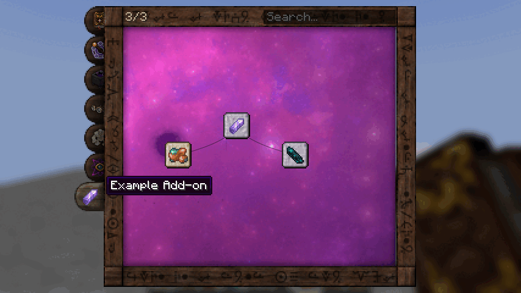
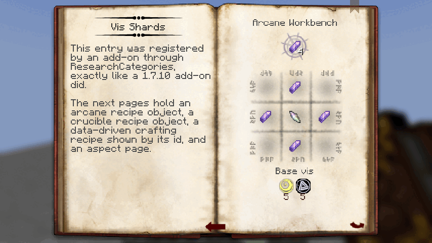
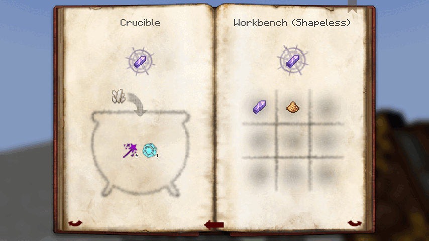
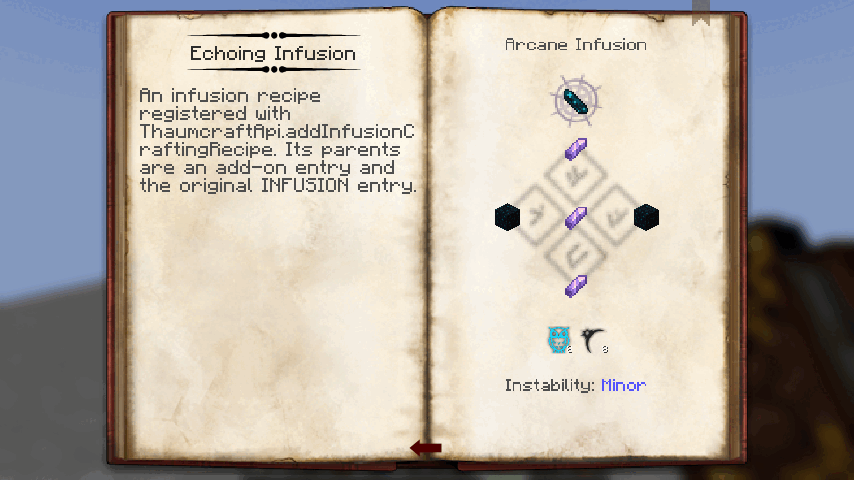
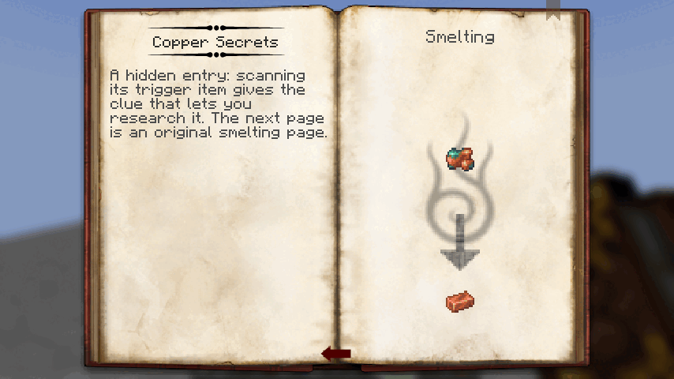
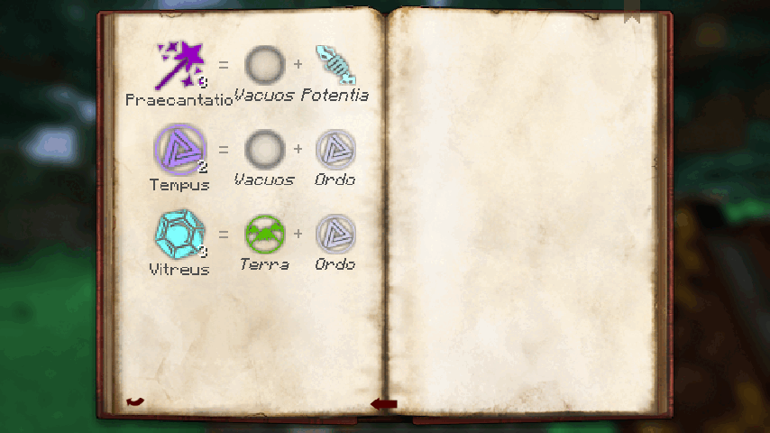
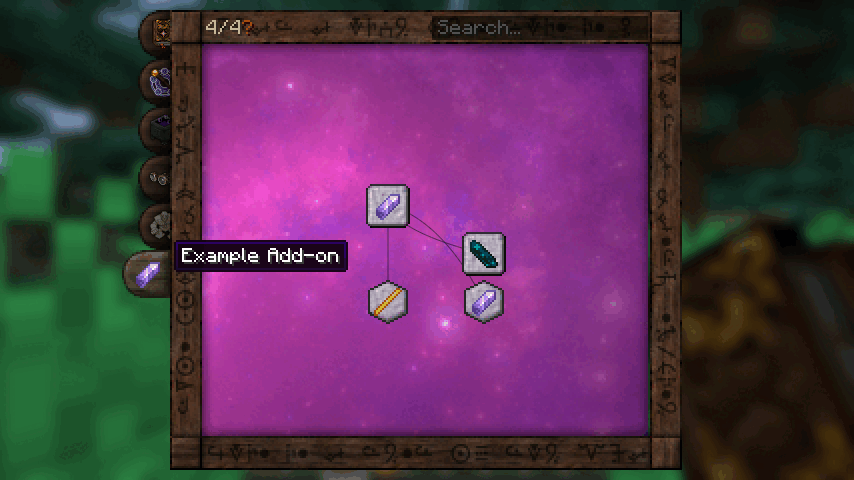
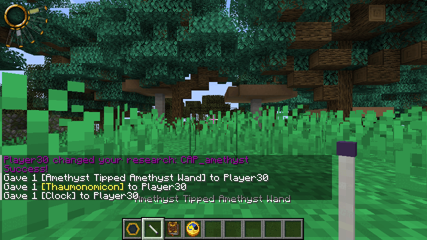
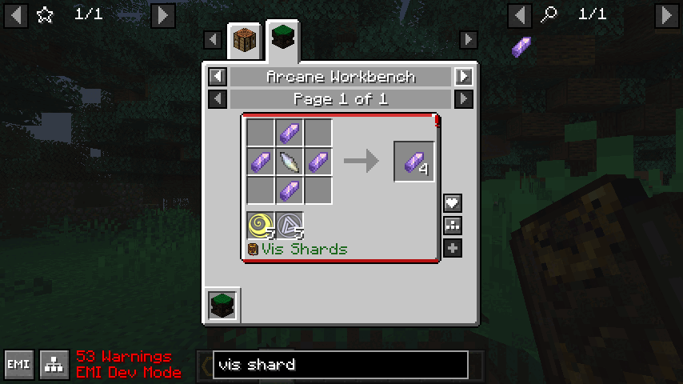

# 26.10.2026 — API для аддонов: перенос аддонов TC4 с 1.7.10

## Задача

Владелец: «вытащить больше API для аддонов, чтобы их можно было портировать со старых версий быстрее и
удобнее». Все 61 класс API оригинала 4.2.3.5 в порте уже были под теми же именами, но аудит показал, что
многие точки расширения существовали только на бумаге: регистрация проходила, а игра её не читала.

## Что было сломано (проверено по коду до правки)

| Место | Было | Стало |
|---|---|---|
| Исследования аддона (`ResearchCategories.addResearch`) | Попадали в карту книги, но книга, стол исследований, покупка, подсказки сканирования, выдача и синхронизация читают `ResearchCatalog` — закрытый корпус из 201 записи. Исследование аддона нельзя было изучить, его страницы не открывались | `ResearchCatalog` — живой вид: корпус, поверх него правки аддонов к оригинальным записям, затем записи аддонов (`AddonResearch`). Все 28 потребителей каталога видят их без правок |
| Страницы аддона | Книга рисовала только страницы корпуса по ключам рецептов | Рисуются объекты `ResearchPage`: рецепты API (магический, тигель, наполнение, зачарование; массивы по одному в секунду), ванильные `Recipe`, страница переплавки и страница аспектов по разметке оригинала, картинка, новая `ResearchPage.recipe(ids)` для JSON-рецептов |
| Вкладки и иконки аддона | Шесть вкладок жёстко; иконка только из выражения корпуса | Вкладки аддонов после шести исходных в порядке регистрации, их иконка и фон; `icon_item`/`icon_resource` записи в карте и во всплывающем окне |
| Порядок инициализации | На Fabric `main` модов идут в произвольном порядке: пример аддона падал с `Unknown item: balance_shard`, потому что запускался раньше Thaumcraft | `IThaumcraftAddon` (точка входа Fabric `thaumcraft`, аннотация NeoForge `@IThaumcraftAddon.Addon`) и `ThaumcraftApi.whenReady` — после регистрации предметов всех модов, аналог `after:Thaumcraft` + `postInit` |
| `registerObjectTag("ingotCopper", …)` | Бросала исключение: «не легаси-имя рудного словаря» | `OreDictionaryNames`: имена, которыми пользовался сам TC4, — его теги `thaumcraft:original_ore/*`; соглашение Forge `<вид><Материал>` — тег `c:`. То же для ингредиентов рецептов |
| Регистрация аспектов по тегу при инициализации | Снимала состав тега в момент вызова, а теги ещё не загружены — молча ничего | Регистрация хранится и применяется при привязке тегов (старт мира, вход клиента на сервер), заполняя предметы без собственной регистрации |
| `IInternalMethodHandler`, перегрузки 1.21.1 | Установленный обработчик API наследовал заглушки (`false`/`null`/ничего) | Делегируют рабочей реализации; плюс операции, которые аддоны брали из `ResearchManager`: выдать исследование, очки аспектов, варп |
| Рецепты API в EMI/JEI | Видны только рецепты тигля | Магические, наполнения и зачарования тоже (стабильные id `api/<вид>/<номер>`) |
| Эффекты | Аддоны 1.7.10 сами собирали пакеты `PacketFX*` | `ThaumcraftFX`: искры, дуга, молния узла, пузыри, поток эссенции, отток вис |

Параллельно три агента в отдельных рабочих копиях закрыли: стержни/колпачки/фокусы аддонов и фасад
`WandHelper` ([отчёт](2026-10-26-addon-wand-parts-ru.md)), аспекты аддонов
([отчёт](2026-10-26-addon-aspects-ru.md)), исходные имена `ConfigItems`/`ConfigBlocks` для `ItemApi`
([отчёт](2026-10-26-addon-legacy-ids-ru.md), таблица [LEGACY_IDS.md](../api/LEGACY_IDS.md)).

Руководство для авторов аддонов — [docs/api/PORTING.md](../api/PORTING.md); рабочий пример —
`examples/example-addon` (собирается в каждой сборке, `ExampleAddonApiOnlyTest` следит, что он импортирует
только `thaumcraft.api`), запуск — `./gradlew :fabric:runExampleClient`. Исходники API теперь лежат в
`-sources.jar` модулей fabric и neoforge, `publishToMavenLocal` настроен.

## Сверка с оригиналом

- `GuiResearchRecipe.drawPage` (байткод 4.2.3.5): ветки TEXT/TEXT_CONCEALED, ASPECTS, CRUCIBLE, NORMAL,
  ARCANE, COMPOUND, INFUSION, INFUSION_ENCHANTMENT, SMELTING; ветки IMAGE нет — такая страница в оригинале
  пустая (в порте рисуется, см. отклонения).
- `drawAspectPage` (:550-603): строка 50 пикселей на аспект, значок ×2 с количеством, имя под ним
  (0x505050), компоненты ×1.5 со смещениями 54 и 96, имена курсивом, «=» и «+» цветом 0x999999,
  «tc.aspect.primal» у примала; подсветка `_back.png` ×2.5 при наведении.
- `drawSmeltingPage`: заголовок `recipe.type.smelting`, рамка печи из листа overlay (u 0, v 192, 56×64 ×2),
  вход в (48, 64), результат в (48, 144).
- `ResearchManager` (`getItemTriggers` → `InventoryUtils.areItemStacksEqual(trigger, stack, true, true,
  false)`): тот же предмет и данные, урон игнорируется.

## Проверки (реальный вывод)

- JUnit: новые `AddonLifecycleTest` (2), `OreDictionaryNamesTest` (4), `ExampleAddonApiOnlyTest` (1),
  `ProgrammaticRecipeViewsTest` (1); полный `:common:test` на итоговом дереве (все три ветки агентов влиты)
  — **2638 тестов, 0 падений**; Python — 130 тестов (7 пропущено), `extract_legacy_ids.py --check` — 0.
- GameTest Fabric: `addonResearchJoinsGameplay` — категория, три записи аддона, стол исследований пишет
  заметку с ключом аддона, выдача через API платит варп, переход по рецепту на нужную страницу, подсказка от
  сканирования предмета-триггера, покупка вторичного исследования, правка оригинального `NITOR` через
  публичный вид, сохранение знаний; `addonHookRanBeforeTheWorld`, `oreDictionaryNamesReachTheTagsOfTheWorld`,
  `effectsOfTheOriginalPacketsAreSent`; полный набор на свежем мире — **Fabric 492/492, NeoForge 480/480**
  (на NeoForge хук аддона вызывается из `FMLCommonSetupEvent`, это проверяет тот же сценарий);
  `:fabric:build :neoforge:build` — PASS.
- Клиент Fabric с примером аддона (`runExampleClient -PwithEmi`): вкладка аддона, иконки, связи, счётчик;
  текст с ` `, магический рецепт, тигель и рецепт верстака по id, наполнение, переплавка, страница
  аспектов с аспектом аддона Tempus; жезл из стержня и колпачка аддона в руке («Amethyst Tipped Amethyst
  Wand» — имя из ключей аддона); магический рецепт аддона из `ThaumcraftApi` в EMI. Первый запуск примера
  упал с `Unknown item: balance_shard` — так и был найден пробел порядка инициализации. EMI в режиме
  разработчика ругался на id синтетических рецептов (`api/...` без `/`, в том числе давний случай тигля из
  API) — id в EMI теперь с `/`, после правки в логе 0 таких ошибок.

## Отклонения

Сводная таблица — `docs/audit/KNOWN_DEVIATIONS.md` §9. Из этой части: страница IMAGE рисуется (в оригинале
пустая); наведение на аспект показывает имя и описание вместо сетки отсканированных предметов; страница
COMPOUND_CRAFTING у аддонов не рисуется; триггеры-предметы без ярлыка рудного словаря; регистрация по тегу
не перекрывает собственную регистрацию предмета.

## Найдено попутно, не исправлялось

- EMI в режиме разработчика пишет «Untranslated tag» для 47 тегов `thaumcraft:aspect_family/*` — у них нет
  ключей перевода (видно только с включённым dev-режимом EMI).

## Не проверено

Мультиплеер с аддоном на клиенте и сервере; клиент NeoForge с примером аддона (пример — модуль Fabric);
JitPack и публикация в удалённый Maven.
