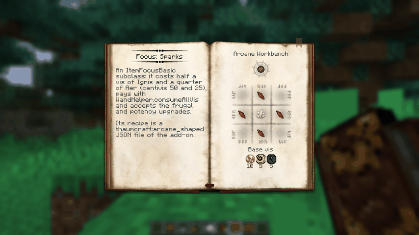
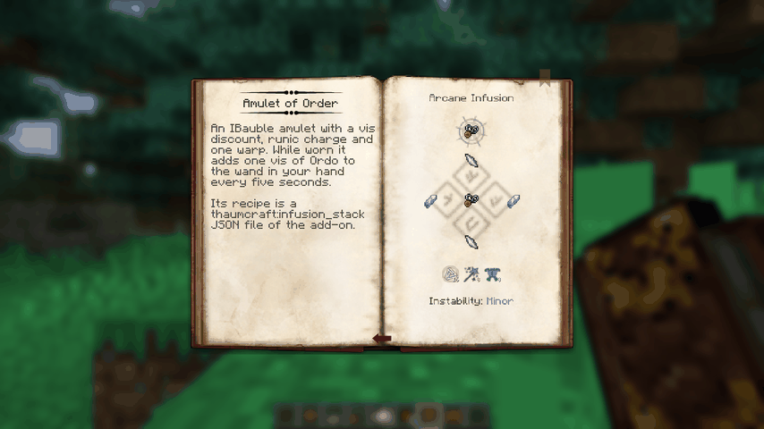
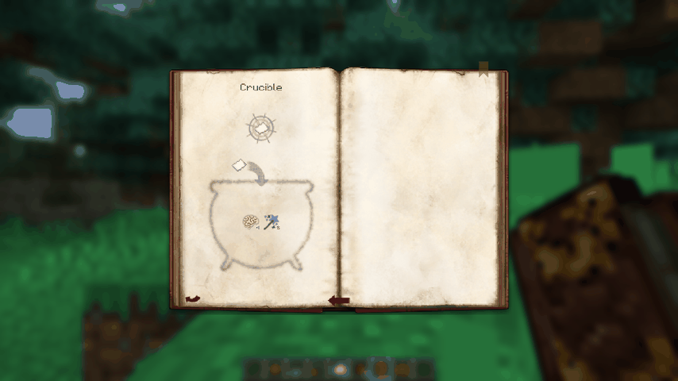
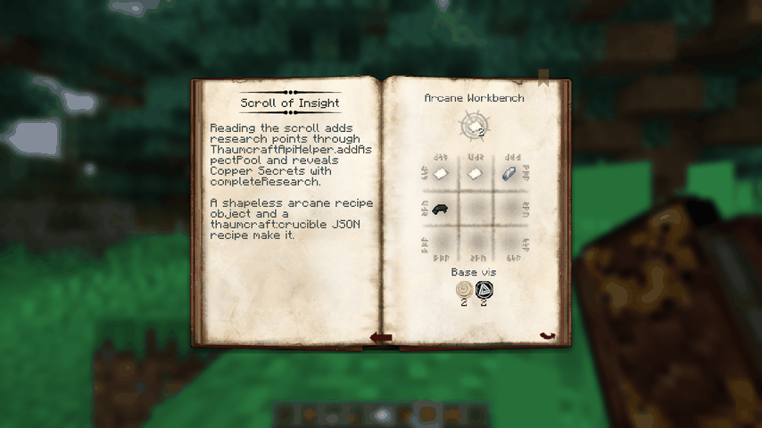
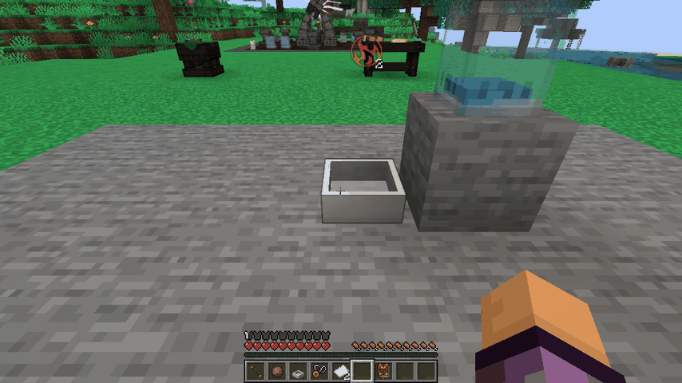
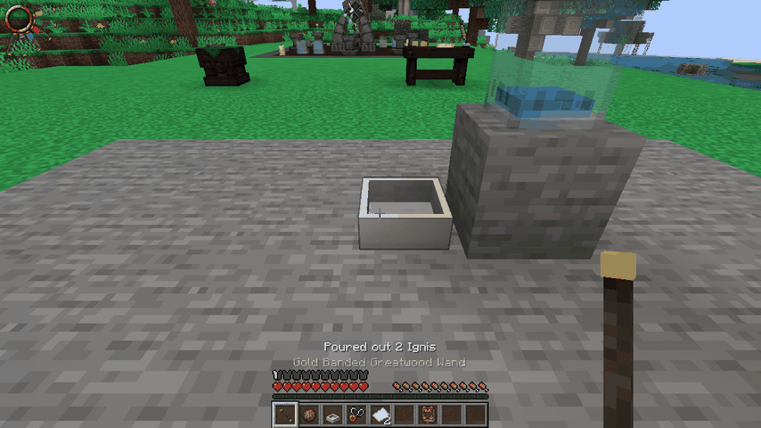
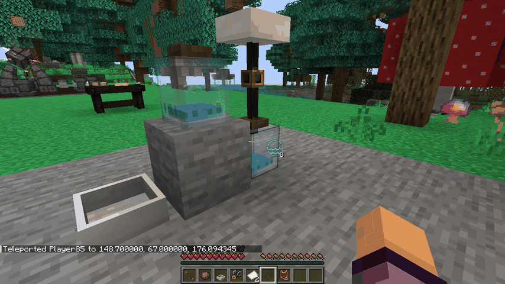
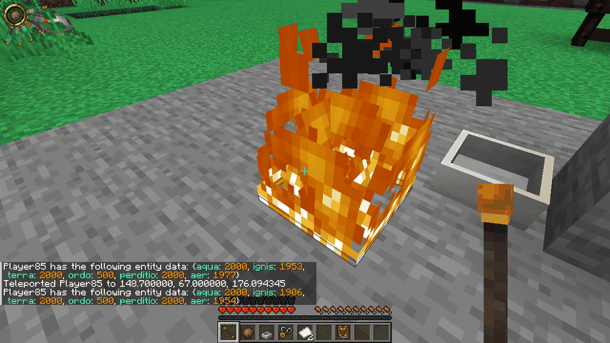
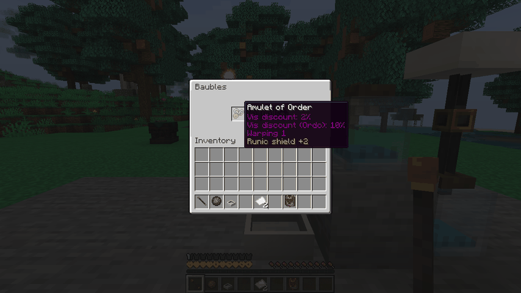
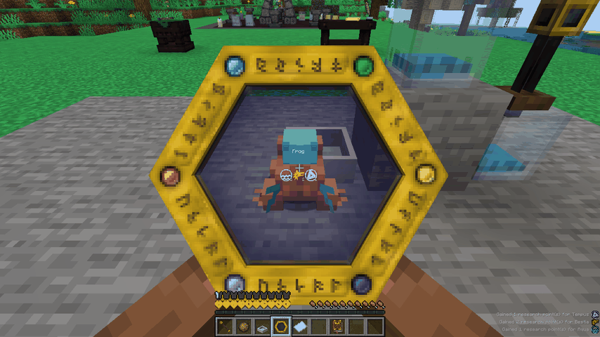

# 26.10.2026 — Документация для авторов аддонов

## Задача

Владелец: «Нужна документация для аддонов». Сделано: руководства на английском и русском, справочник API,
создаваемый из Javadoc, и пример аддона, из которого руководства берут код. Во время проверки примера в клиенте найдены
и исправлены пять дефектов API — без исправлений руководства описывали бы то, что не работает.

## Что появилось

| Часть | Где | Как не даёт устареть |
|---|---|---|
| Указатель | `docs/api/README.md`, `docs/api/ru/README.md` | — |
| 8 руководств (EN) | `docs/api/guide/`: начало работы, аспекты, исследования, рецепты, жезлы и фокусы, блоки/эссенция/вис, снаряжение и безделушки, содержимое и мир | фрагменты кода вставляет `scripts/porting/api_docs.py` |
| 8 руководств (RU) | `docs/api/ru/guide/` — те же страницы | тест требует тот же набор страниц и фрагментов |
| Справочник API | `docs/api/reference/` — 18 страниц, каждый публичный тип и член `thaumcraft.api` с Javadoc | `java scripts/porting/ApiReference.java --check` |
| Пример аддона | `examples/example-addon`: + фокус, блок с блок-сущностью (контейнер, транспорт эссенции, `IWandable`), амулет-безделушка, свиток знаний, хук стержня, сложный тег, тег существа, бесформенный магический рецепт, 4 рецепта JSON родных типов, бонус переплавки, варп за крафт, мешки добычи, 4 новые записи исследований | компилируется каждой сборкой; `ExampleAddonApiOnlyTest` — только `thaumcraft.api` |

`scripts/porting/api_docs.py --write|--check` копирует в руководства области примера между `// [doc:имя]` и `// [/doc]`
(блоки `<!-- snippet:имя -->`) и файлы целиком (`<!-- file:путь -->`). `scripts/porting/test_api_docs.py` (8 тестов,
идёт в CI вместе с остальными Python-тестами): руководства совпадают с примером, каждая область показана в EN и RU,
у каждой страницы EN есть RU, относительные ссылки и якоря существуют, справочник не устарел (пропускается без `java`).
Генератор справочника теперь показывает varargs как `Object...`, а не `Object[]`.

## Дефекты API, найденные по ходу (исправлены)

| Дефект | Как найден | Исправление | Проверка |
|---|---|---|---|
| Варп от снаряжения не учитывал надетые безделушки; оригинал `WarpEvents.getWarpFromGear` (байткод 4.2.3.5) читает 4 слота Baubles | сверка с байткодом при описании `IWarpingGear` | `WarpGear.fromGear` добавляет 4 слота аксессуаров | GameTest `addonBaubleCountsOnlyWhenWorn` |
| `onUnequipped` не вызывался, когда безделушку снимают обычным кликом в меню: `removeItem` спрашивал опустевший исходный стак (его предмет уже воздух) | новый GameTest упал | спрашивается снятый стак | тот же GameTest (до правки падал «taken off: onUnequipped ran…») |
| `TileThaumcraft` не отдавал данные с чанком: клиент не видел содержимого до первого обновления | описание `getDescriptionPacket` | `getUpdateTag` = собственные данные | `TileThaumcraftSyncTest` |
| Опустевший контейнер на `TileThaumcraft` оставался полным на клиенте: клиент 1.21.1 пропускает обновление с пустым тегом (`ClientPacketListener.handleBlockEntityData`, проверено по байткоду) | клиент: чаша опустошена, очки показывают 3 Ignis | обновление всегда несёт ключ `thaumcraft:update` | `TileThaumcraftSyncTest`; клиент — всплывашка исчезает |
| Трубы, банки, буферы, центрифуги, кристаллизаторы и т. д. не брали эссенцию у `IEssentiaTransport` аддона — только у своих внутренних конечных точек (в TC4 любой приёмник вызывал `takeEssentia` соседа) | клиент: чаша → труба → банка, ничего не переходит | `EssentiaTransfers.foreignSource`: кредит приёмника готовится, источник платит своим `takeEssentia`, излишек возвращается через `addEssentia` | GameTest `addonEssentiaSourceFeedsTubesAndJars` (без правки: «6 / 0»); клиент — банка получила 8 Aqua |
| Матрица наполнения не брала эссенцию у `IAspectSource` аддона (в TC4 — `takeFromContainer` любого источника) | тот же разбор | `consumeFromForeignSource` по образцу зеркала: источник платит первым, лишнее возвращается | GameTest `addonAspectSourcePaysTheInfusionMatrix` (без правки падает) |

Исправлен и Javadoc: `IWandable.onWandRightClick` возвращает не «стоимость в вис», а знак обработки (отрицательное —
не обработано, 1 — взмах), как в байткоде `ItemWandCasting.onItemUseFirst`; `getActivationCooldown` фокуса — в
миллисекундах реального времени (как `WandManager` оригинала), а не в тиках; описаны контракты `onFocusRightClick` и
`IWarpingGear`.

## Сверка с оригиналом

- `WarpEvents.getWarpFromGear`: основная рука, 4 слота брони, 4 слота Baubles; `EventHandlerRunic.getFinalWarp` —
  только `IWarpingGear.getWarp`.
- `ItemWandCasting.onItemUseFirst`: `IWandable` блока, затем блок-сущности; `ret >= 0` — обработано, `ret == 1` — успех;
  `onUsingTick`/`onPlayerStoppedUsing` зовут `IWandable` только для объекта из `getObjectInUse` (NBT, ставит
  внутренний `setObjectInUse`).
- `TileTube.addEssentia`: прибавляет 1 при любом положительном количестве — излишек источника в оригинале терялся
  (в порте возвращается; записано в KNOWN_DEVIATIONS §9).
- `ItemEssence` реализует `IEssentiaContainerItem` (NBT); в порте фиалы — два предмета с компонентом и интерфейс не
  реализуют — пробел, записан в §9 и в руководствах.

## Проверки (реальный вывод)

- JUnit `:common:test` — **2640 тестов, 0 падений** (все 425 файлов результатов из этого запуска).
- Python — **138 тестов, OK (7 пропущено)**; `api_docs.py --check` и `ApiReference.java --check` — актуальны.
- GameTest на свежих мирах: **Fabric 495/495, NeoForge 483/483** (+3 новых сценария: безделушка аддона, источник
  эссенции аддона, матрица наполнения с источником аддона). Негативные контрольные: без правки транспорта —
  «the jar took all six units from the add-on source: 6 / 0»; без правки наполнения — «one unit leaves the add-on
  source…».
- `:fabric:build :neoforge:build` — PASS.
- Клиент Fabric с примером (`runExampleClient`, мир Showcase, Xvfb): вкладка аддона с новыми записями; страницы
  рецептов JSON (магический, наполнение, тигель) и бесформенный магический объект API с именем рудного словаря;
  чаша: кристаллы Ignis заливаются, очки показывают количество, клик жезлом опустошает с пузырями и сообщением, после
  правки всплывашка исчезает; чаша → труба → банка переносит 8 Aqua; фокус ставится на жезл (цвет на модели),
  бьёт молнией и поджигает, платит 47 Ignis и 23 Aer за каст (50 и 25 со скидкой очков 5 %); амулет надевается в слот
  амулета, подсказка и золотые сердца рунного щита, пополняет Ordo жезла в руке; свиток добавляет по 2 очка
  первичных и 1 Tempus, открывает скрытую запись; сканирование лягушки даёт Aqua 2, Bestia 2, Tempus 1; стержень
  аддона пополняет Ordo.

Попутно: тихоня забирает предмет из руки по правому клику (ваниль), поэтому таумометр её не сканирует — пример взял
лягушку, руководство об этом предупреждает. Всплывашка очков выше блока при взгляде сверху — не ошибка, а исходное
смещение над блоком.

## Не проверено

Клиент NeoForge с примером (пример — модуль Fabric); мультиплеер с аддоном; в клиенте не проверялись сгущение Ordo
из сети вис (нет сети рядом), сложный тег при старте сервера, бонус переплавки, варп за крафт амулета и мешки добычи
примера (сами механики покрыты прежними тестами, вызовы примера — нет).

## Пробелы, оставленные открытыми (записаны в руководствах и KNOWN_DEVIATIONS §9)

- `IWandable.onUsingWandTick`/`onWandStoppedUsing` не вызываются (нет аналога `setObjectInUse`).
- Фиалы не реализуют `IEssentiaContainerItem`.
- Первичные аспекты аддонов не хранятся в жезлах, амулетах и ретрансляторах (как и раньше).
