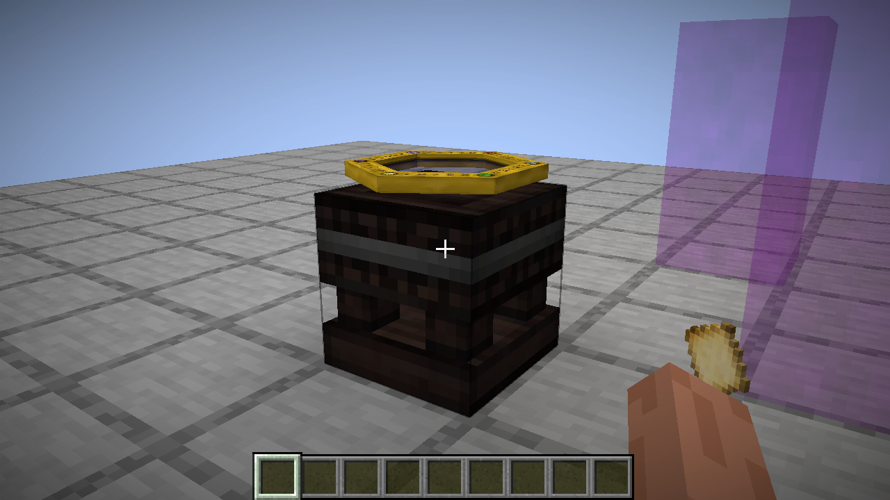
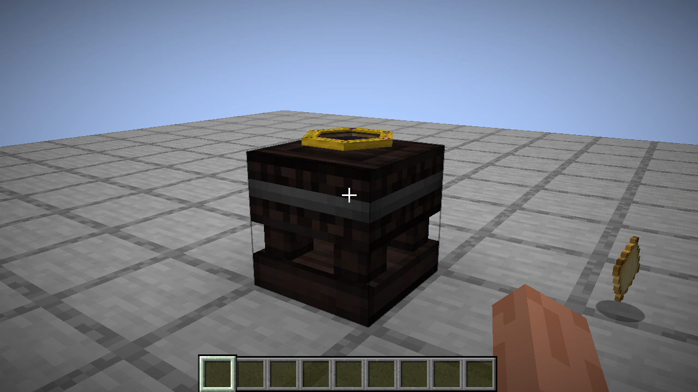
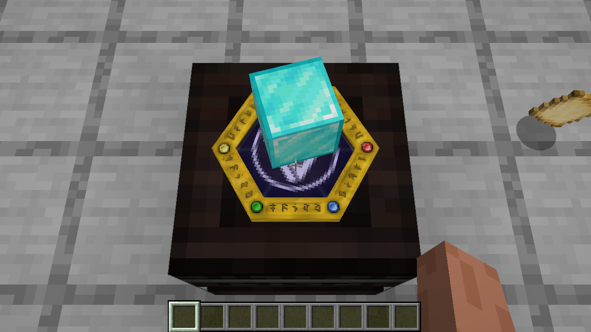
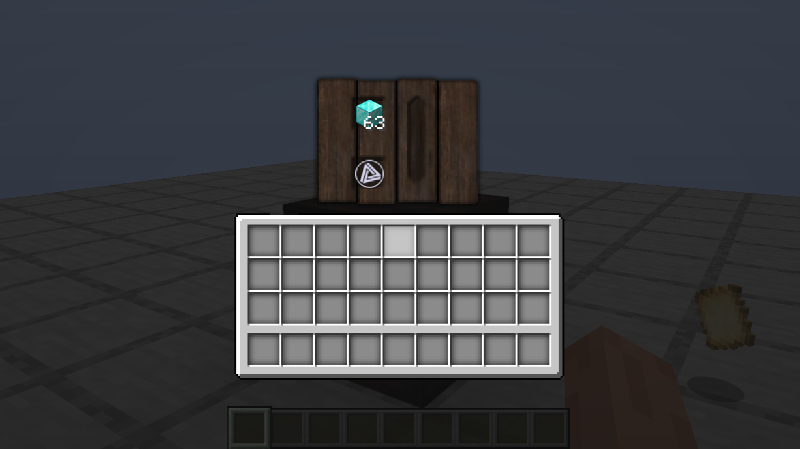

# Расщепитель в поставленном мире: 01.11.2026

После alpha.10 владелец попросил отдельно осмотреть поставленный расщепитель. Предыдущий обход покрывал его значок и рецепт, но не отдельную мировую сцену. Здесь проверен настоящий Fabric/Minecraft 1.21.1 client, Java21, Xorg/llvmpipe: пустой стол спереди, сзади, сбоку, сверху и снизу, входной предмет, естественно полученный результат, настоящий GUI, закрытое тёмное помещение и resource reload.

Использованы отдельные копии собственного мира 1.21.1. Стол и 64 алмазных блока явно выданы в creative fixture. Сам разбор выполнен обычным серверным ticker: стек уменьшился с64 до63, появился primal; в итоговом проходе — Ordo. Объектные аспекты не подменялись, вычисленная сумма исходных primals432. Это не survival acquisition и не multiplayer. NeoForge client не запускался.

## Текстура и дефекты

`textures/models/decontable.png`128×64 побайтово совпадает с сохранённым TC4 ресурсом: SHA256 `0a916f79cf770d0502ad42a13200babe8b37a236c6c42c63c6056b1085962305`. Шесть частей стола, UV и материал не требуют перекраски. Оригинальный JAR локально отсутствует; сверка проведена по сохранённым ресурсам и readonly TC4 4.2.3.5 Java oracle.

Живой осмотр обнаружил слишком большой и высокий таумометр: его экран перекрывал плоскость результата. Причина — пропущенный внешний Forge ENTITY helper, а не PNG. Официальные `ForgeHooksClient.java` и `RenderItem.java.patch` закреплены на [MinecraftForge1.7.10,9274e4fe435cb415099a8216c1b42235f185443e](https://github.com/MinecraftForge/MinecraftForge/tree/9274e4fe435cb415099a8216c1b42235f185443e). SHA256 файлов соответственно `b76301f71f005999b75a16bb6559becd41479427a8e3596c6b85cbfb524bf787` и `7dc84771af88e3f0df28b9093967eaf9e6ec86ef03f95115a64bbfe7e4c38822`; MCP stable12 подтверждает `field_82407_g = renderInFrame`.

Восстановлена исходная цепочка после table translate(.5,.92,.5)/scale(.8): bob(.1), frame scale1.25, translateY.05, rotateY−90, non-block BLOCK_3D scale.5, затем собственный scanner scale.5. Современный ground display lift3/16 явно компенсируется, чтобы не прибавлять подъём второй раз. Общий helper используется и для значка предмета, и для поставленного стола.

| Параметр | Alpha.10 | Исправлено / оригинал |
|---|---:|---:|
| Итоговый масштаб OBJ | .4 | .25 |
| Центр по Y | 1.07 | 1.05 |
| Экран по Y | 1.114 | 1.0775 |
| Символ результата по Y | 1.081 | 1.081 |
| Поворот frame по Y | отсутствует | −90° |

Экран теперь ниже символа на исходные .0035 блока. Размер рамки уменьшился в1.6раза; в финальных нативных кадрах символ виден на экране.

У символа результата также исправлены перевёрнутый V и режим смешивания. Оригинальные вершины `(-8,+8),(+8,+8),(+8,-8),(-8,-8)` получают UV `(0,1),(1,1),(1,0),(0,0)`. Вместо entityTranslucent применяется существующий scanner glyph RenderType: SRC_ALPHA/ONE, alpha.8, lightmap без normal shading, оригинальный порог alpha1/255. Его shader lifecycle уже зарегистрирован обоими loaders и переиспользуется после reload. Fullbright не добавлен: исходный drawTag не отключает lightmap. В полной темноте символ сохраняет наследуемое освещение.

Внешние GL alpha.75/blend входного предмета в oracle сами по себе не доказывают его прозрачность: RenderItem может сбрасывать colour. Входной renderer по этому предположению не изменялся.

## Проверки и воспроизводимость

До исправления:11 нативных кадров, frozen common SHA256 `3b7341da07caf3cbe6b438264bff886364b4df761f4644517d8f433e07de7656`. После:13 кадров, frozen common SHA256 `0a9a1fdef14aa1277fb14c036c8d0a85410bf706952bdb21fbb4f2db89fc86b4`; настоящий resource reload, 0 script/render failures. Журнал фиксирует загруженный BER и его codeSource, клиентские input/reward, sky/block light15/0 днём и0/0 в закрытом помещении. Все13 окончательных кадров осмотрены; независимый review проверил исходную цепочку и результат сверху/сбоку. Случайные primal и фаза вращения между прогонами не фиксировались; попиксельное A/B равенство не заявляется.

Новый регрессионный тест проверяет исходные UV, colour, alpha204, сохранение packed light и отсутствие overlay/normal. Проверка позы интегрирует настоящий native ItemTransform и фиксирует scale.25, Y1.0775, frame rotation и положительный зазор до glyph. Сохранены прежние проверки геометрии стола и JSON display transforms.

Common JUnit2847 (0 failures/errors,5 прежних JAR-dependent skips), Fabric build/production isolation — PASS. Python155 (9 прежних skips), assets0 missing — PASS. Результаты NeoForge записаны в release notes после отдельной сборки. Полный новый обход всей книги, NeoForge client и survival progression не заявляются: это целевой осмотр расщепителя.

Полные24 PNG, логи, входные manifests, frozen common JARs и временный helper остаются в игнорируемом `.tmp/deconstructor-visual`. В репозиторий входят только выбранные нативные кадры; оригинальные decompile/JAR и миры не публикуются.

## Кадры

До:

После:

