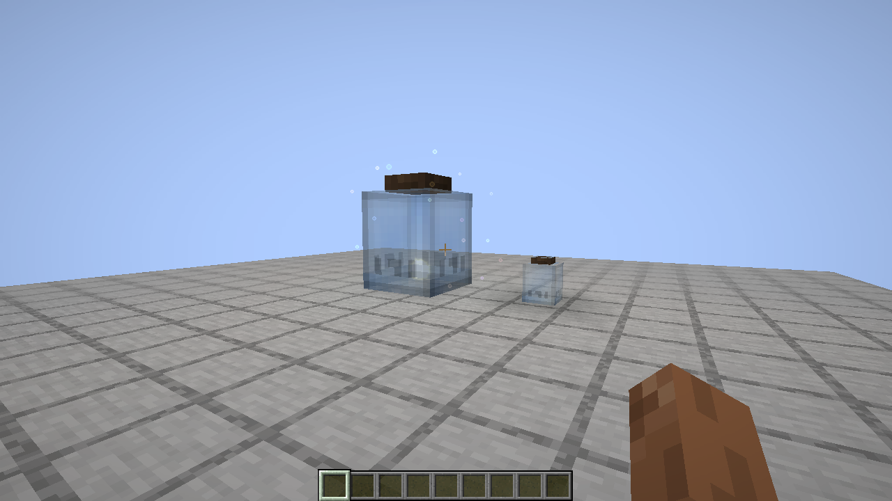
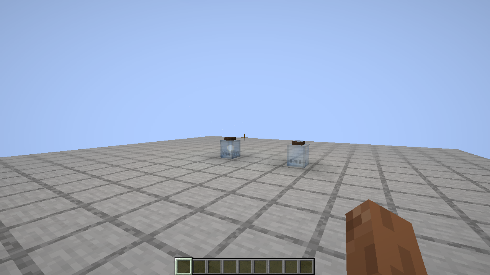

# Узел ауры в банке: завершение механики

Запрос владельца: исправить захват, видимое сжатие, выпуск и потерю данных банки. Базис — alpha.8 (`9eabd06e`), основной код `main`.

## Подтверждённые дефекты

Native диагностический сценарий `.tmp/nodejar-check/run-loss.log` подтвердил отсутствие захвата и исключение при выпуске: старый код ставил `airy[variant=0]`, хотя native node — отдельный `aura_node`. Флаг `drop=false` устанавливался до ошибки: последующее обычное разбивание давало банку без аспектов. Новая проверка полного lifecycle обнаружила ещё один дефект: item `BLOCK_ENTITY_DATA` не содержал обязательный `id`, поэтому сохранение заполненной банки падало в native ItemStack codec.

## Правила оригинала

Oracle `WandManager:207–221,262–332`, `ConfigRecipes:95–96`: структура 3×4×3, 26 обычных glass и девять деревянных плит сверху. Узел находится в центре слоя на один блок выше дна. Активация жезлом по **стеклу**, с изученным `NODEJAR`. Затраты — 70 целых vis каждого из шести primals с обычными модификаторами жезла/экипировки. Содержимое, тип и id переносятся; base становится текущим запасом. Исходный шанс ухудшения качества 75% сохранён: BRIGHT → обычный, обычный → PALE, PALE → FADING; FADING остаётся FADING. Перенос предметом и последующий выпуск больше не меняют качество. Выпуск бесплатный.

## Реализация

`NodeJarFormation` проверяет полную загруженную структуру, разрешения и ресурсные snapshots до commit. Приватный кадр закрывает reentry; текущие цена и разрешения проверяются повторно после callbacks. Vis списывается до native lifecycle callbacks и сохранения игрока; 35 блоков оболочки потребляются до UNLOAD узла. Старый объект передаёт запас и опустошается до UNLOAD. Native block entity factory однократно получает заранее заполненную банку/узел, привязанную к уровню операции; чтение состояния передачи не создаёт BE. LOAD может сразу разбить или напрямую удалить нового владельца: это завершённый перенос, исходный узел не восстанавливается. Удаление учитывается до UNLOAD, включая прямой `removeBlockEntity`, поэтому кешированный удалённый объект не сосуществует с возвращённой второй копией. При отмене до регистрации нового владельца vis возвращается до native LOAD заранее заполненной копии исходного узла, а оболочка восстанавливается первой. Не затираются посторонние блоки; невосстановимые собственные материалы и единственный payload переходят в сохранённую очередь предметов. Neighbour/client feedback выполняется после определения владельца. Это не гарантия атомарного checkpoint нескольких чанков при произвольном отключении питания.

Готовая банка сохраняет зарегистрированный BE id, аспекты, node type/modifier/id в native item codec. Выпуск создаёт `aura_node` с данными до onPlace; rejected release сохраняет исходные данные и filled drop.

## Видимое сжатие — запрос владельца

В оригинальном `TileJarRenderer:107–115` scale выполнялся после draw calls и не влиял на vertices. Владелец явно попросил закончить видимую механику: event9 включает секундное уменьшение shell 3→1 и node 1→0.7. `JarBlock` для node jar теперь рисует стеклянную оболочку через BER; ранее его inherited INVISIBLE не рисовал shell. Другие jar types не изменялись. Таймер очищается, после загрузки банки/ресурсов не перезапускается.

Реальный Fabric client: `.tmp/nodejar-visual/run/visual-report.txt`, пять PNG в `run/screenshots`, metadata/hash evidence `.tmp/nodejar-visual/verification.json`. Виден узел без очков, большой/средний/обычный размер shell и сохранение после resource reload. Использован явно выданный creative fixture на копии GameTest world, это не survival acquisition. Входы renderer после осмотра не менялись. Серверные transfer guards после клиентского осмотра доработаны отдельно; это не повтор всего клиента на конечной сборке. В startup log остаются offline auth/audio/fixture-option warnings; исключений renderer/reload не было.

Начало и конец видимого сжатия (один creative fixture, без очков):

## Проверяемые переходы

Пять общих native GameTest проверяют захват → native harvest → ItemStack codec → native placement → выпуск → harvest узла; research, цену, настройки экипировки, game mode, callbacks и границы загруженных чанков. Три Fabric protection GameTest проверяют настоящие break/use veto и попытку перехватить заполненную factory в другом Level. Девять Fabric lifecycle GameTest вызывают настоящие native LOAD/UNLOAD: оплата до сохранения игрока, пустой старый источник, первый harvest без подготовительного getter, однократная factory, прямое удаление, сохранение чужого блока, откат до admission и аварийная доставка единственного payload через очередь. Эти сценарии не добавлены в production JAR.

## Итоговая проверка

Окончательные источники, Java 21, версия `0.1.0-alpha.9`:

- Common JUnit: **2803**, 0 failures/errors, 5 прежних пропусков без оригинального JAR.
- Сначала Fabric: focused node jar **17/17**, затем `:common:test :fabric:build :fabric:runGameTest` — **559/559** GameTest на свежем мире, сборка и production/test isolation PASS.
- Затем NeoForge: focused node jar **7/7** (пять общих + два native protection), затем `:neoforge:build :neoforge:runGameTest` — **538/538** GameTest на свежем мире, NeoForge JUnit **15/15**, production/test isolation PASS. Native NeoForge BREAK/PLACE preflight проверен на реальном `gameMode.useItemOn`, в том числе без повторного capture snapshots внешним item-use wrapper.
- Python: **143**, 9 прежних пропусков; catalogue parity PASS; assets **0 missing references**; scope **0 stale fingerprints**; `git diff --check` PASS.
- Логи сохранены локально: `.tmp/nodejar-check/final-focused3.log`, `final-fabric2.log`, `neo-focused.log`, `final-neoforge.log`, `final-python.log`, `assets.log`, `scope.log`. Предыдущие отклонённые прогоны сохранены отдельно и не являются этой приёмкой.

Осмотрены клиентская анимация и resource reload на Fabric, с выданным creative fixture (см. выше). NeoForge client, multiplayer и получение узла по survival-прогрессии не перепроходились. Это завершение конкретной механики, не заявление о полной приёмке всего порта.
