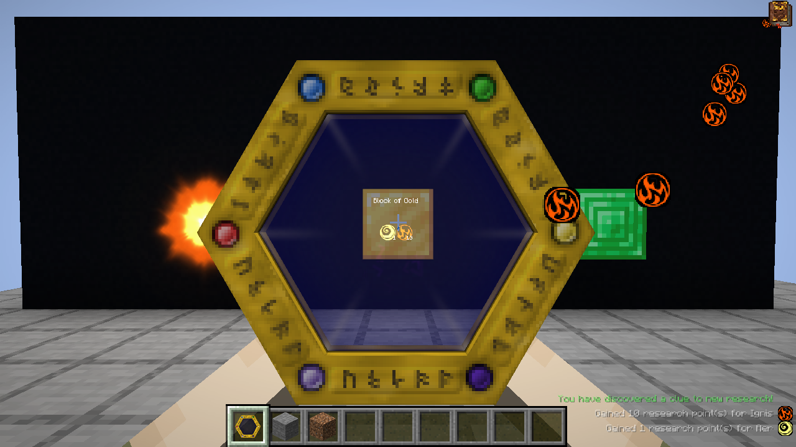
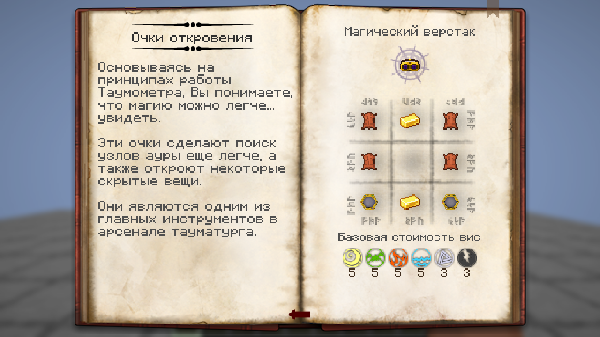
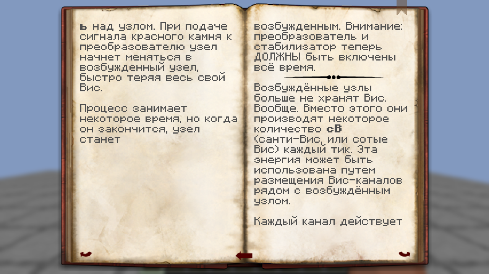
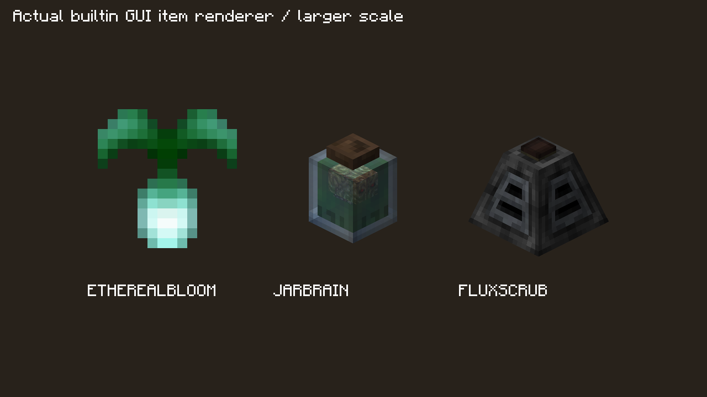
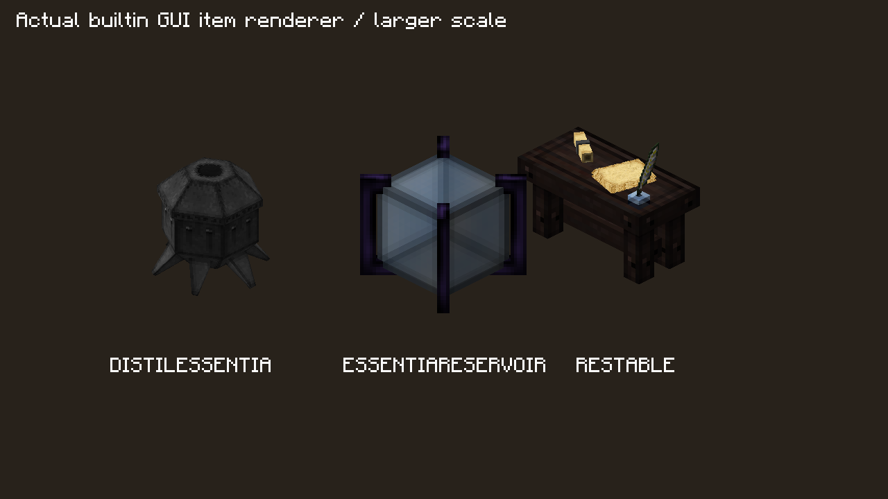

# Таумометр и полный Таумономикон: проверка 01.11.2026

Запрос владельца: проверить текстуры таумометра вживую, затем каждый рецепт и каждый значок Таумономикона. Базис — `main` 730cf503, alpha.9; исправления включены в alpha.10.

## Границы и источник правил

Правила сверены с каноническим TC4 4.2.3.5 Java oracle, сохранённым извлечением ресурсов и `docs/porting/resource-manifest.json`. Оригинального JAR в рабочем каталоге нет: новая побайтовая сверка с самим JAR не заявляется. Oracle `ConfigRecipes.java` SHA256 `45ab9dc6772fcb51dba83d04221d4b910c85fe013706a333ba65ab4d56abfc58`; поля Minecraft проверены по MCP stable12 для 1.7.10 (архив SHA256 `83d303a80071582cd07d41b35aa77c178d609a27c69c8472b794636eb50905b0`). Оригиналы не менялись и в коммит не входят.

Клиентские прогоны — настоящие Fabric/Minecraft 1.21.1, Java21, Xorg/llvmpipe. Использованы отдельные копии собственного мира 1.21.1 и явно выданные знания/предметы. Это осмотр интерфейса, а не получение предметов по survival-прогрессии.

## Полный каталог

- 201 запись исследования в шести категориях; две служебные записи без страниц.
- 591 исходный дескриптор: 310 текстовых и 281 с рецептами/специальными выражениями.
- На стандартной конфигурации 192 невиртуальных доступных исследования и 576 дескрипторов: 303 текстовых и **273 с рецептами**. Семь условных разделов Silver/Lead/Tin отключены; их 15 исходных страниц классифицированы, а не названы просмотренными в доступной книге.
- Все 308 оригинальных именованных ссылок разобраны: 291 рецепт, три anchors конструкций, шесть остальных конструкций и восемь условных рецептов металлов. 48 вариантов ярлыков и восемь специальных массивов учтены отдельно. Проверены количества, ингредиенты/катализаторы/центры, costs, research, instability, 24 цели зачарований, 16 цветов знамён и точные компоненты зелий.
- Для каждого языка проверены 708 ключей локализации и 29 иллюстраций. Пропусков нет; RU отличается от сохранённого оригинала лишь конечными пробелами.

## Таумометр

Корпус, экран, OBJ, пиктограммы аспектов и их UV соответствуют сохранённым оригинальным ресурсам. Дефекты находились в рендере: `eyes` давал `ONE/ONE` без lightmap вместо `SRC_ALPHA/ONE`; screen RenderType перебивал `blur=true`; порядок аспектов зависел от количества. Исправлены исходный порядок, частичная прозрачность, lightmap и отдельная фаза яркости каждого столбца, additive-текст и фильтрация экрана. Использован уже зарегистрированный lit particle shader с исходным порогом alpha; новый shader lifecycle не добавлен.

Equip progress теперь независим для каждой логической руки и учитывает выбранную основную руку игрока. Нативные снимки одной камеры: до исправления верх рамки при переключении основной руки — 97/77/97 px, после — 97/97/97. Выпавший прибор вращается вокруг своего центра. Генератор больше не заменяет builtin/OBJ-модель плоским UV-атласом.

Живой A/B: по 15 кадров, inventory, обе руки, фактический scan, известные аспекты, узел, смена hotbar, третье лицо, выпавший предмет, resource reload. Нативный GL sampler: до LINEAR metadata → NEAREST при рисовании, после LINEAR; glyph blend после `SRC_ALPHA/ONE`. Сами PNG не перекрашивались. Основная рука сохраняет исходную полную видимость узлов; поведение второй руки по отношению к видимости узлов этим исправлением не расширялось.

## Исправленные рецепты

| Рецепт | Было | Оригинал / исправлено |
|---|---|---|
| Таумометр | Четыре осколка по углам | Два осколка по центру верхней и нижней строк |
| Костяной стержень | Mortuus 6 | Exanimis 6 |
| Глиняный голем | Блок глины | Кирпичный блок |
| Забрало голема | Кожаный шлем | Железный шлем, произвольный износ |
| Броня голема | Кожаная кираса | Железная кираса, произвольный износ |
| Эссенциевое зеркало | Три алмаза | Три железных слитка |
| Лампа плодородия | Золотая морковь | Морковь |
| Древний глаз | Слиток пустотного металла | Семя пустоты |

Старые данные проваливают все десять новых точных проверок; исправленные проходят. Обновлены соответствующие fixtures, а не ослаблены проверки ресурсов. Метаданные зелий не были отброшены: native predicates сохраняют точные strong/long и splash типы. Для BottleTaint оригинальный matcher игнорирует NBT фиала; это сохранено, но preview показывает исходные Vitium8.

## Страницы и значки

Восстановлены шесть схем: Таумономикон, магический и исследовательский столы, тигель, адская печь, узел в банке. Добавлены пропущенные очистка ярлыка и переплавка сбалансированного кристалла в Salis Mundus. Это реальные схемы/рецепты, а не пустые страницы. Существующие три послойные схемы сохранены.

Исправлены blend каждого символа vis после вывода текста, bonus sparkles и preview улучшенного голема: материал результата соответствует выбранному входу. Жирный текст преобразуется в styled spans до переноса: legacy `§r` больше не сбрасывается к унаследованному BOLD при повторной bidi-обработке строки. Дефект RU VISPOWER воспроизведён нативно: 153px в колонке 139px. Переводы не переписывались.

Устранены 25 пустых значков в доступных разделах и ещё шесть разрешимых условных значков; оставшийся CAP_silver не имеет native предмета и отключён. Два служебных null-значка намеренны. Проверены реальные wand/banner/node prototype components и все wildcard cycles.

Восстановлены подписи текстур Arcane Ear, исходные полные спрайты двух зеркал, purifier_seed для эфирного цветка, оба слоя решётки, украшение фокуса обмена, advanced/core слои всех восьми големов, цветные привязанные и чистые пустые ярлыки. Inventory-модели стола расщепления/исследовательского стола, банки с мозгом, очистителя, перегонного куба и резервуара используют исходные детали, а не неполные заменители. Общие части вынесены без фиктивных BE/мира; исправлены также отсутствовавшие мировые оболочки банки/резервуара и TRIANGLES для mesh очистителя. Генератор сохраняет эти модели.

Проверена полная таблица исходных inventory dispatch/селекторов: 66 типов, 89 классов, 158 методов. Существующие корректные модели не заменялись по одному подозрительному thumbnail. Проверка частично отсутствующей текстуры проходит по всем BakedQuad sprites, а не только по whole-model missing flag.

## Живой обход и итоговые результаты

Промежуточный полный обход D9: до исправлений книги — 612 кадров; после первого набора — EN633 и RU631. Все 576 доступных исходных дескрипторов и 273 рецепта присутствуют; 415 вариантов рецептов, 201 ячейка значков, 48 аспектов, шесть категорий и wildcard cycles отрисованы нативными GUI. Исходные 784 разворота и 830 variant cells просмотрены людьми по читаемым contact sheets с раскрытием сомнительных полных кадров. Эти прогоны обнаружили последующие дефекты отдельных моделей/слоёв и RU bold reset; они не объявляются конечной визуальной приёмкой.

Окончательный Fabric client, common jar SHA256 `3b7341da07caf3cbe6b438264bff886364b4df761f4644517d8f433e07de7656`: **EN647/647, RU645/645**, 0 ошибок, настоящий resource reload в обоих. В каждом языке присутствуют все **576/576** исходных доступных дескрипторов (**273 рецепта и 303 текста**); нативная пагинация — 720 EN / 712 RU. Отрисованы по **415 вариантов** рецептов, все 201 ячейка исследования, 48 аспектов, циклы 8 големов/8 руд/6 стрел, шесть категорий, крупные предметы и четыре настоящих мировых BE до и после reload. Все 29 иллюстраций на язык найдены ResourceManager.

Измерены реальные `FormattedCharSequence` через нативный Font: **5256 EN + 5324 RU строк**, максимум139px, переполнений0. Проверены 32 состояния големов и 49 состояний ярлыков, точные модели, цвета и прототипы; 0 missing-model/partial-quad ошибок во всех выгрузках до/после reload. Пусты только два служебных значка и отключённый CAP_silver. Все804 ячейки исследований и192 glyph-ячеек аспектов просмотрены; активный SINSTONE пиксельно совпадает с сохранённым оригиналом в четырёх фазах. Мировые brain jar/flux/alembic/reservoir осмотрены в запущенной игре. Окончательные **830/830 variant cells и18/18 native blueprint spreads** вручную просмотрены поимённо, новых дефектов не найдено.

`docs/porting/thaumonomicon-visual-audit.json` содержит поимённые записи **308 рецептурных ключей и201 значка**, обе нативные раскладки и SHA256 всех1292 окончательных PNG. Полные кадры/fixture inputs и runtime dumps остаются в игнорируемых `.tmp/thaumonomicon-visual/final-{en_us,ru_ru}`; выбранные кадры опубликованы ниже. Исходные прогоны не переименовывались в конечные.

Сборка Fabric и common JUnit **2846** (0 failures/errors, 5 прежних пропусков), GameTest **559/559** — PASS. Python **155** (9 прежних пропусков), assets **0 missing references** — PASS. Затем NeoForge build, production/test isolation и GameTest **538/538**, NeoForge JUnit **15/15** — PASS. Catalogue parity и scope (0 stale fingerprints) — PASS. NeoForge client и multiplayer не запускались.

## Выбранные нативные кадры

