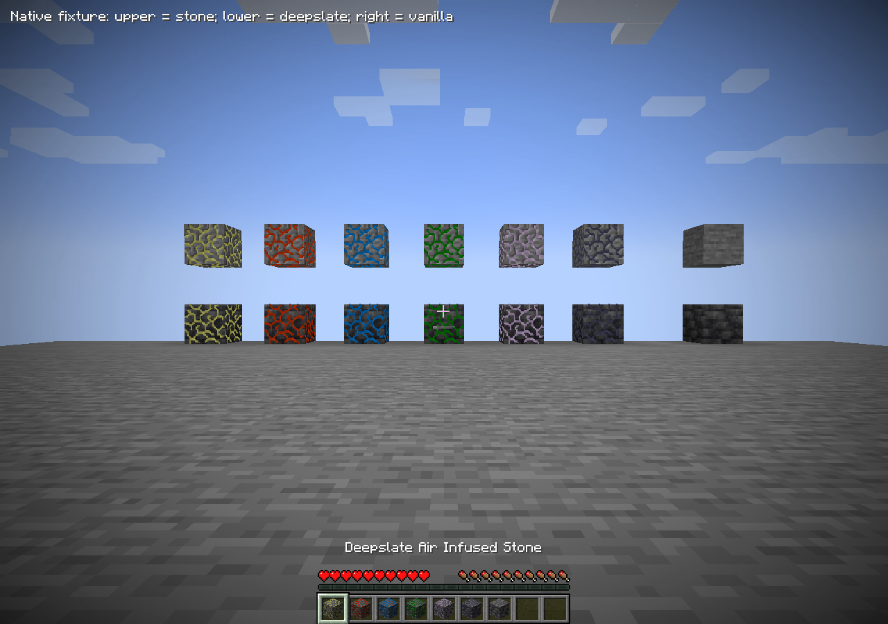
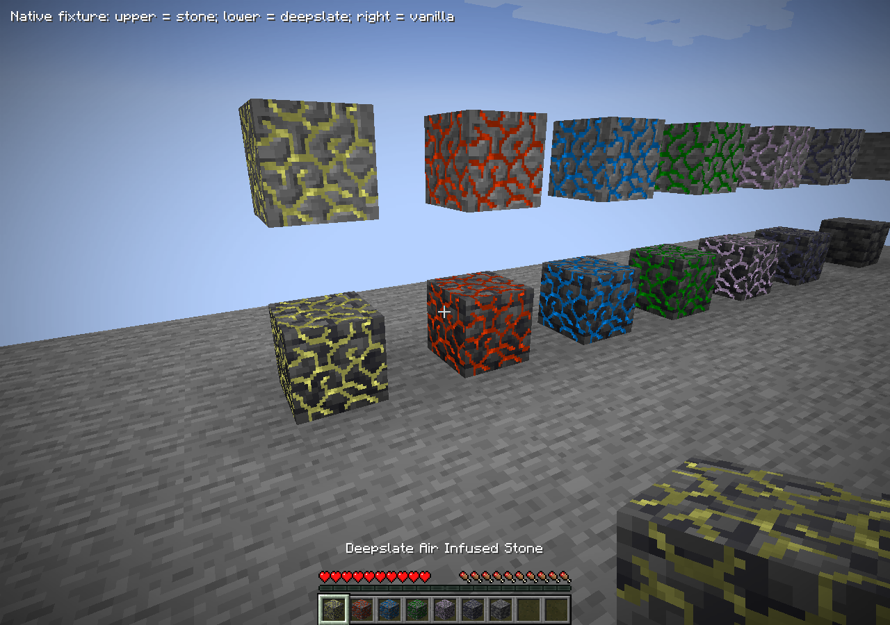
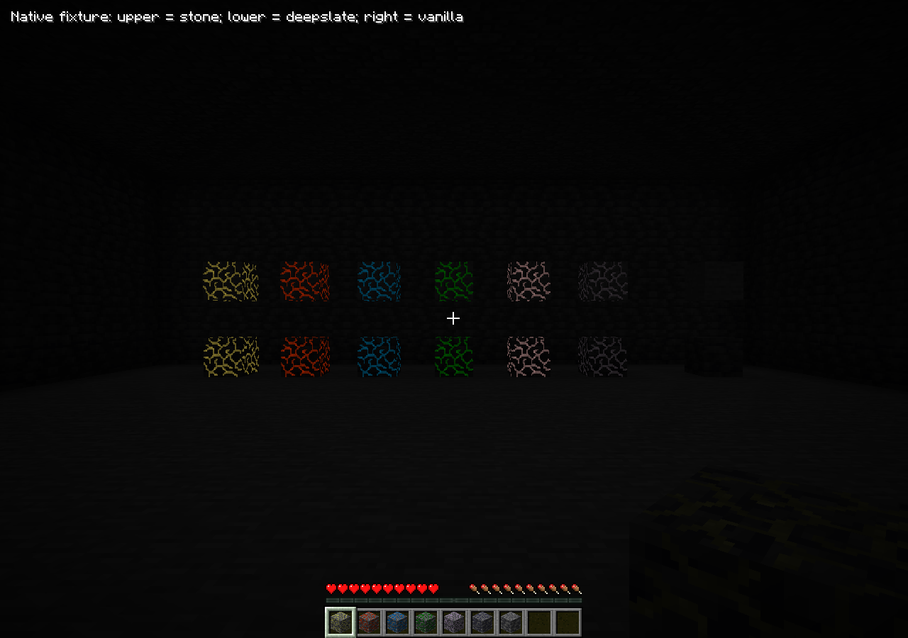

# Глубинная кристаллическая руда — alpha.16

По запросу владельца добавлены шесть вариантов `deepslate_*_infused_stone` для Aer,
Ignis, Aqua, Terra, Ordo и Perditio. Это дополнение к геологии Minecraft 1.21.1 в базе
Thaumcraft; исходные кристаллические кластеры и рецепты их изготовления не менялись.

Блоки используют ванильные `minecraft:block/deepslate` и `deepslate_top`, исходную
анимированную `infusedore.png` и прежние шесть оттенков. PNG не перекрашивались и не
копировались из Minecraft: ресурс-паки сохраняют возможность заменить ванильный камень.
Прозрачная кристаллическая поверхность чуть вынесена над непрозрачной породой, поэтому
не исчезает внутри блока и не спорит с основанием по глубине. Исходный дополнительный
внутренний stone-pass для этих непрозрачных блоков пропускается; старые модели сохранены.

Новые блоки имеют прочность 3, взрывоустойчивость 6 и звуки глубинного сланца. Добываются
обычной киркой: осколки, Fortune и XP соответствуют исходной руде. Silk Touch возвращает
новый глубинный блок. Добавлены EN/RU имена, creative listing, общие/исходные ore-теги,
такие же аспекты для сканирования/алхимии, бонус исследовательского стола и допуск к
ускоренной добыче фокусом. Киноварь и янтарь в этой работе не расширялись.

Генерация сохраняет обычные попытки каменной руды. В переходном слое подходящий
глубокосланцевый host получает новый вариант; дополнительно ниже Y=0 выполняются восемь
попыток жил размера 6 по ванильному тегу deepslate ore replaceables. Старые biome/dimension
ограничения и настройка `generate_infused_stone` действуют на оба прохода. Чанки не
подгружаются генератором принудительно, неразрешённые области пропускаются. Обычные старые
чанки автоматически не конвертируются; существующий явно включаемый retrogen остаётся
отдельным путём. Это новая согласованная адаптация, не утверждение об исходной TC4 геологии.

## Проверка

- Java21, Fabric build и production/test isolation — PASS.
- 13 focused JUnit: исходные/новые аспектные привязки, полное покрытие ресурсов реестра,
  отказы генерации вне высоты/загруженной/разрешённой области без изменения RNG — PASS.
- 4 native GameTests — PASS: новая добыча/дроп и глубинная генерация, прежние добыча,
  переплавка и получение осколков для таумометра из обычной естественной руды.
- Во свежем normal-noise регионе `x96..99,z96..99,Y=-64..-1` найдено 382 новых блока:
  Aer 120, Ignis 29, Aqua 51, Terra 63, Ordo 55, Perditio 64. Все проверенные ячейки нижнего
  бедрока сохранены; отключённый проход не расходует RNG. Это реальная генерация без
  расстановки тестовых руд; добыча дополнительно проверяет реальные loot tables и survival.
- 71 Python asset tests — PASS; missing resource references 0. Валидатор разрешает только
  два явно проверенных ванильных host-спрайта и по-прежнему отклоняет ошибочные внешние
  имена. Reviewed composed-resource inventory обновлён: новые фабрики создают IDs рецептов,
  блоков/аспектов/тегов, а не новые вычисляемые пути файлов. Ранее добавленный `+` книги
  не меняет её корпус изображений; deep guard не меняет исходные семейства stone-спрайтов.
- Реальный Fabric client+EMI: восемь осмотренных PNG, шесть пар normal/deep рядом с
  ванильными породами, стороны/торцы, темнота со sky light 0, инвентарь EN/RU и resource
  reload. Native models содержат правильные host/overlay sprites; block/item tint совпадает
  с исходным, overlay содержит 16 кадров анимации. Выданная галерея не является новым
  прохождением survival. Multiplayer и NeoForge здесь не проверялись.
- Обычный production Fabric server: итоговый JAR + FabricAPI + Architectury, свежий мир,
  50 тиков, save-all/stop, exit 0 и mapping errors 0 — PASS.

Итоговый `Thaumcraft-fabric-0.1.0-alpha.16.jar`:
`cd2a501b614eb1be396e72592edc2d75918986456bce8a1416297567b7754cee`.
Точные входы и SHA восьми PNG: [машинный отчёт](../porting/deepslate-ore.json).

