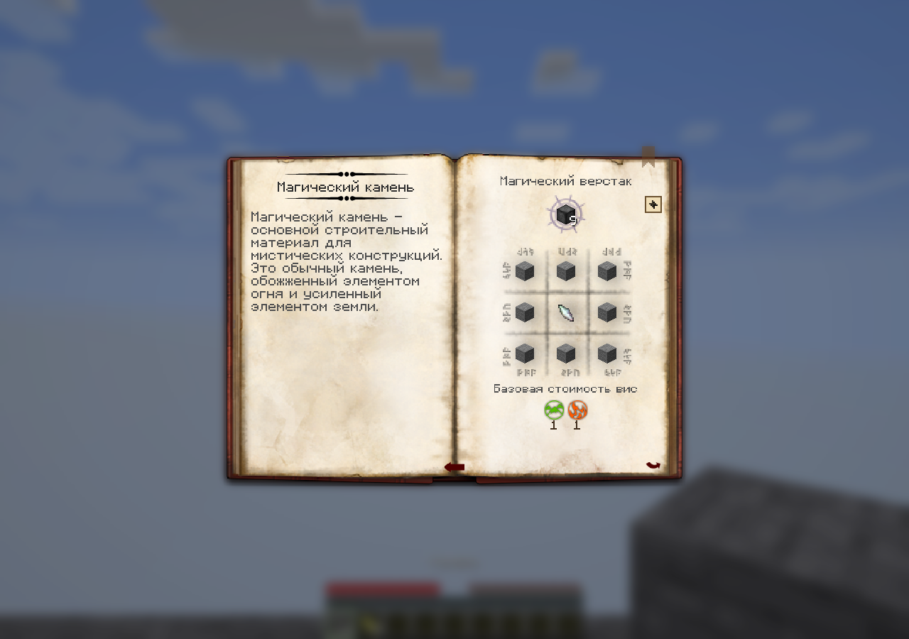
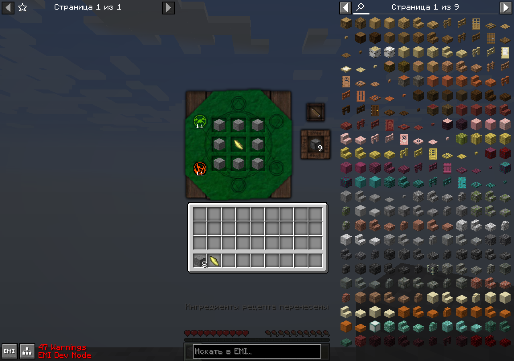
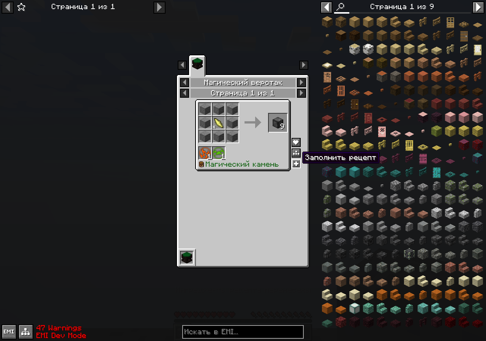
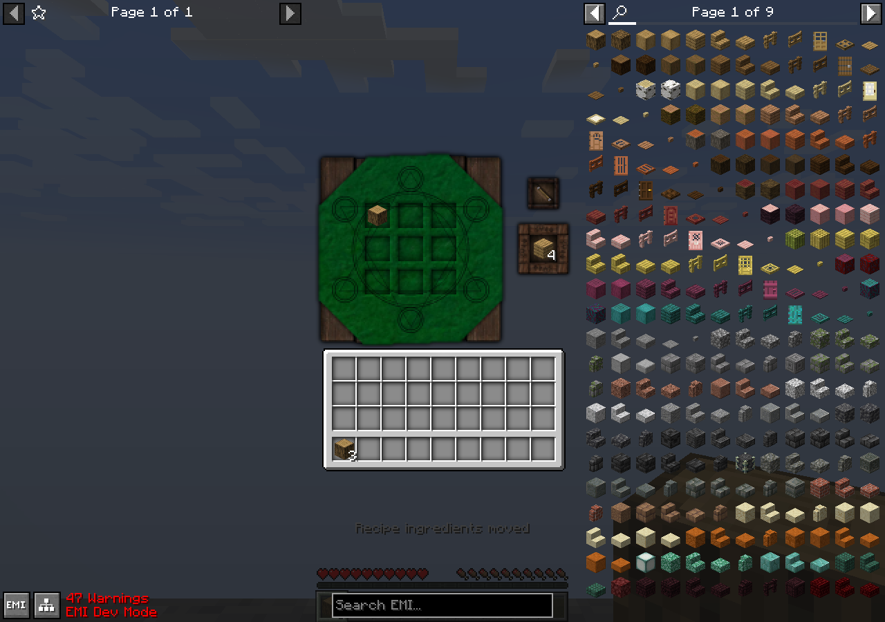

# Перенос рецептов в Thaumcraft — alpha.14

По запросу владельца перенос реализован в базе Thaumcraft. В Refined Thaum ничего не
изменено. В таумономиконе появился `+` у поддерживаемого рецепта; существующий обработчик
EMI теперь использует тот же серверный механизм. Обычный клик раскладывает один набор,
Shift — максимальное число полных наборов. Открытая книга может найти и открыть ближайший
доступный магический верстак в пределах реальной дальности взаимодействия игрока.

Поддержаны обычные shaped/shapeless, фиксированные магические JSON/API-рецепты, варианты
жезлов/скипетров EMI и показанный вариант динамической страницы скипетра в книге. Схемы
мировых конструкций, тигель и наполнение не являются матрицей верстака и не получают кнопку.
Показанный в книге вариант привязан к последнему отрисованному рецепту и текущему контексту
экрана; перепагинация, изменения знаний и перезагрузка ресурсов инвалидируют старый выбор.

Сервер принимает ID рецепта и контекст меню, самостоятельно проверяет рецепт/исследования,
считает материалы с сохранением компонентов и возвращает прежние ингредиенты в инвентарь.
Матрица и 36 ячеек основного инвентаря/hotbar заменяются вместе до уведомлений; палочка,
броня и вторая рука не участвуют. Нехватка предметов/места не меняет инвентари. Перенос не
берёт результат и не списывает vis: это остаётся обязанностью обычного native crafting.
Для уже правильно заполненной матрицы одиночный запрос сохраняет имеющиеся количества.

Сложные пересечения ингредиентов обрабатываются ограниченным поиском. Предварительное
сопоставление ёмкостей и оптимистичная оценка оставшихся ячеек исключают дорогой перебор
заведомо невозможных вариантов полного инвентаря. Публичные `RecipeTransferTarget` и
`RecipeTransferPlan` дают аддонам отдельный контракт атомарного переноса; адаптер внешнего
RS-хранилища в этой работе не добавлялся. [Контракт API](../api/guide/recipe-transfer.md).

## Проверка

- Java21, Fabric build и production/test isolation — PASS; тестовые моды/EMI не вложены в JAR.
- 6 focused JUnit: защитное копирование плана, границы/кодек/поддельные поля запроса — PASS.
- 7 focused native GameTests — PASS: standalone book admission, один/максимум,
  компоненты/пересечения/варианты жезлов, нехватка/полный инвентарь, сохранение/закрытие,
  исследования/vis, устаревшая сессия/дальность, обычные shaped/shapeless и прежний native
  тест оплаченного крафта. Регрессия восьми компонентных вариантов по64 проверяет максимум32
  на девять ячеек и атомарный отказ при девяти вытесняемых видах предметов; весь этот тест45ms.
- Настоящий Fabric client + EMI1.1.22, без Refined Thaum: EN → RU → EN после resource reload.
  9 реальных GUI-кликов отправили ровно9 наблюдённых C2S; проверены серверная матрица,
  конечный остаток выданных предметов, неизменная палочка, невыбранный результат,
  craftable и синхронизированные primal prices. Получены18 PNG; шесть итоговых кадров
  непосредственно осмотрены root, полный первый проход также осмотрен клиентским агентом.
- Обычный production Fabric server с точным итоговым JAR, Fabric API и Architectury:
  свежий мир1.21.1, 51 обычный тик, save-all/stop, exit0, mapping errors0 — PASS.
- Сгенерированная API reference и guide snippets актуальны.

Это конечный выданный creative fixture, не повторное получение предметов в survival.
Новый полный обход всех рецептов/значков, multiplayer и NeoForge не заявляются. Логи,
два свежих клиентских мира и полные18 кадров остаются в игнорируемых run/.tmp каталогах.
Выбранные PNG и [машинный отчёт с SHA](../porting/recipe-transfer.json) сохранены в репозитории.

Итоговый `Thaumcraft-fabric-0.1.0-alpha.14.jar`:
`9edd3a4266848052ca3d46cdb525aa3dd4718b80af77b9592b55f3d65e4a1e8d`.

## Кадры

