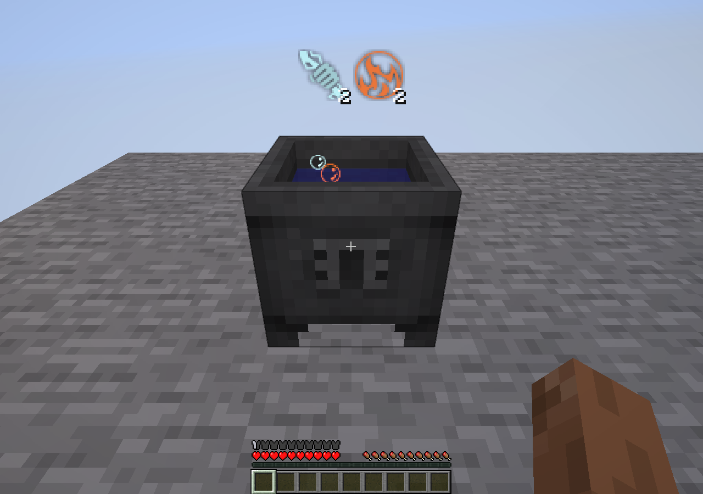
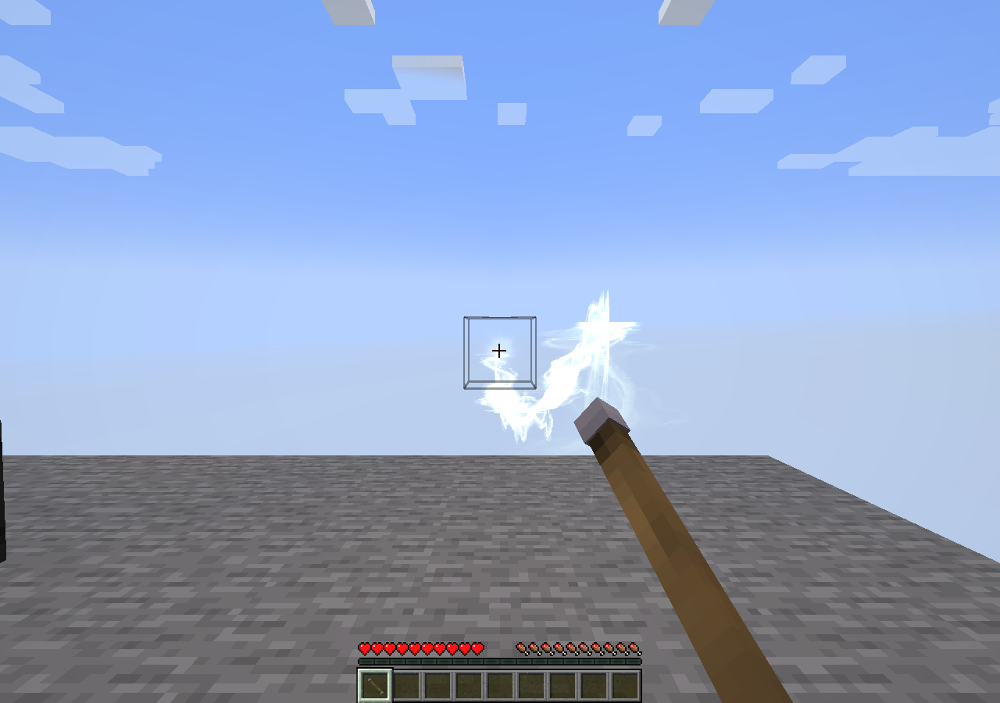
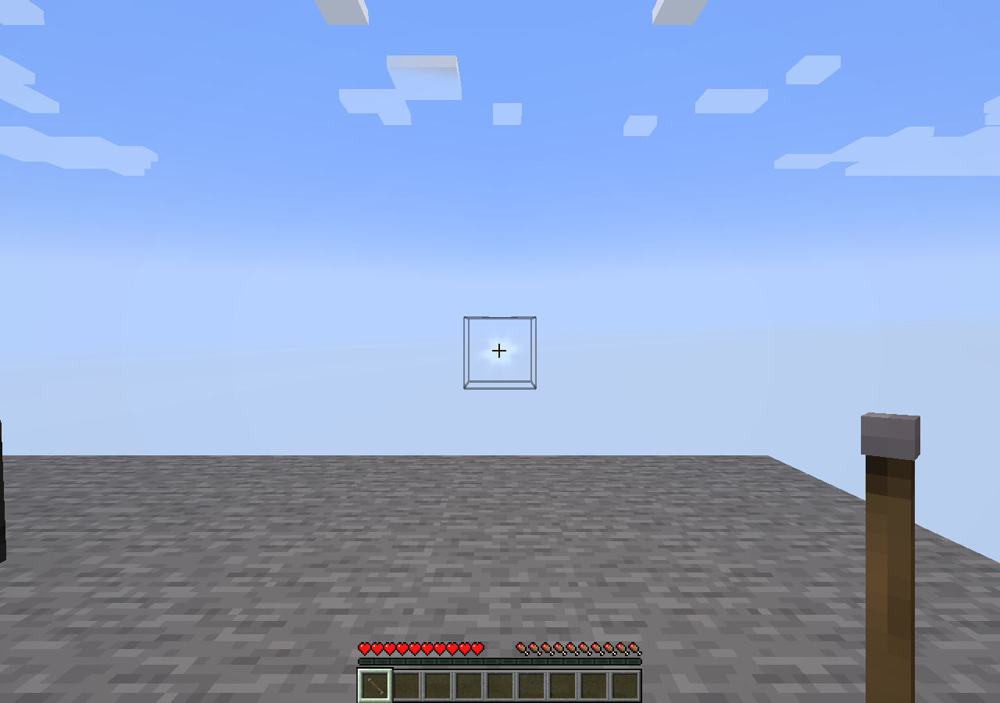

# Тигель и зарядка жезла — alpha.15

Владелец сообщил о невидимых аспектах тигля и уточнил, что при зарядке от узла жезл от
первого лица постоянно проигрывает доставание, а поток частиц отсутствует. Исправления
внесены в базовый Thaumcraft; Refined Thaum не изменён. Перенос рецептов alpha.14 сохранён.

## Причины и изменения

`ThaumcraftGogglesClient.targetView` читает `IAspectContainer`, однако нативный `TileCrucible`
не реализовывал этот оригинальный интерфейс. Тиглю возвращён интерфейс TC4 с исходными
инертными insertion/extraction/query методами. Существующий копирующий getter и физическая
алхимия сохранены. Надетые очки/совместимый `IGoggles` по-прежнему обязательны; неизвестный
аспект показывается вопросительным знаком. Тигель не стал новым трубным приёмником.

`ItemInHandRenderer.tick` сравнивает полные компоненты стека. Синхронизация количества vis
делала старый и новый жезл разными и запускала опускание/поднятие руки. Узкий client mixin
сохраняет равенство только при изменении vis у того же жезла; материалы, фокус, скипетр,
имя, количество и остальные свойства сохраняют обычную проверку. Нативный use-session
не переписывался: `LivingEntity` уже продолжает использование того же вида предмета.

Порт не содержал исходного drainer/color эффекта `TileNodeRenderer`. После фактического
grant/debit сервер теперь передаёт визуальный S2C с dimension, позицией, actor ID/UUID и
цветом. Клиент рисует существующий `FloatyLine` с исходной `wispy.png` до проверки
видимости самого узла; поток зарядки не требует очков. Состояние имеет короткий TTL,
проверяет актуального игрока/мир/использование и прекращается после отпускания кнопки.
Сбой визуальной доставки не отменяет оплату и не повторяет передачу vis. Fake/mock
игроки без настоящего соединения не участвуют в доставке. Параметры цвета/позы опираются
на retained TC4 oracle `TileNode.onUsingWandTick:441–448` и `TileNodeRenderer:200–223`.

## Проверка

- Java21, Fabric build, test/production isolation — PASS.
- 3 JUnit: payload identity/bounds и исходное целочисленное сглаживание цвета — PASS.
- 4 native GameTests — PASS: настоящий контракт тигля после растворения, vis-only
  идентичность зарегистрированного жезла, прежние drain/regeneration и rounding tests.
- Свежий обычный production Fabric server с итоговым JAR: 50 тиков, save-all/stop,
  exit0, mapping errors0 — PASS.
- Настоящий client: лава нагрела воду, физический предмет угля растворился в тигле.
  Проверены Ignis2/Potentia2 через очки, неизвестный знак, отсутствие HUD без очков,
  RU после resource reload и оба открытых аспекта. Затем обычный use-пакет удерживал
  зарядку естественного узла без очков 80 тиков. Все 80 samples имели equip height 1.0 и
  непрерывно растущий use counter; жезл получил 1600 centivis, узел30→14. Наблюдены 16
  реальных визуальных pulses и 183 вызова отрисовки линии. После отпускания active0.
- Все 9 итоговых PNG осмотрены. В fixture явно выданы очки/уголь/пустой wood/iron жезл
  и естественный узел Aer30; это не получение предметов в survival. Multiplayer,
  NeoForge и новый полный обход книги не заявляются.

Итоговый `Thaumcraft-fabric-0.1.0-alpha.15.jar`:
`14679c4ebbe340d60ecfb4ee2e65d31fb45238f209486a7a1c388c3409b818d4`.
Полные данные, 80 samples и SHA кадров: [машинный отчёт](../porting/wand-crucible.json).

