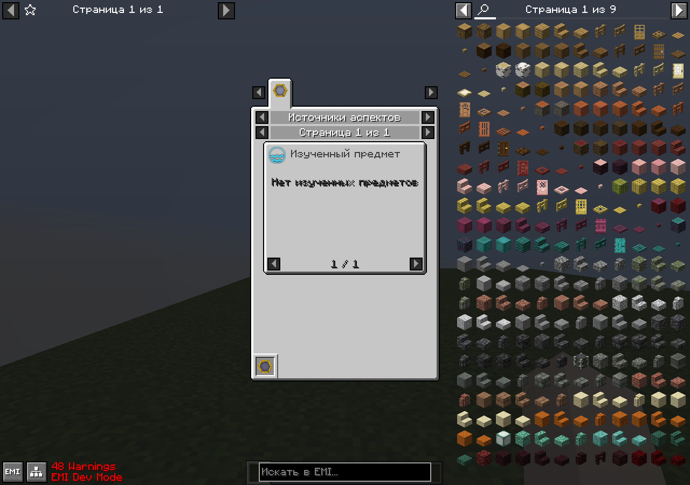
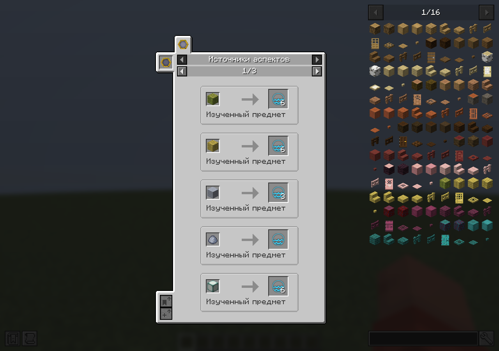

# Aspect-source lookup performance and world isolation

The reported opening slowdown had two concrete causes. EMI resolved the aspects
of every known item again every 50 milliseconds on the render thread. JEI treated
each new collection wrapper returned by `getAllIngredients` as a changed catalogue,
then scanned and sorted it again; its repeated handled-output checks also repeated
the full aspect lookup.

Both viewers now share a client source-index implementation. Item aspects and
empty results are cached; stable aspect lookups read immutable published lists.
The client tick prewarms missing items with a 2 ms target for the derivation loop.
The budget is checked between items; a single resolver call, metadata validation,
candidate filtering and publication are not a strict whole-tick time bound.
Rendering does not derive the catalogue, and EMI reuses its ingredient stacks.

`PlayerKnowledge.itemScanRevision()` changes only when item-scan membership changes.
Ordinary/advanced replacements, resets and same-size replacements invalidate the
index; unrelated research/aspect-pool snapshots do not. The revision is not saved
or synchronized as player data. Actual JEI ingredient mutations use the public
ingredient listener rather than collection-wrapper identity.

Each index permanently belongs to its original client connection. Disconnect or
connection replacement retires it and clears its results; retained old widgets
and ingredient providers cannot rebind to the next world. Same-connection level
transitions clear results without prematurely retiring a joining/respawning player.
Retirement also releases the connection reference. A new viewer registration owns
the new world's index.

The cache checks public object tags, nested mutable aspect amounts, recipe views
and inference settings once per second. Changed metadata queues fresh derivation;
the canonical resolver still supplies every amount. An actual-client check changes
the public clay-ball Aqua amount to 11 and restores it, verifying both updates.

Cold JEI queries show an aspect-only loading placeholder, with no unknown input
items. Once ready, the visible placeholder queues a completed-list refresh with `tell`,
checking the exact screen before updating it. Thus initial preparation does not
perform a synchronous full-catalogue lookup or require reopening the screen.

The focused native probes supply scans through the normal server API/knowledge
packets in a fresh first world, then create a fresh second world without restarting
the client. They preserve retained first-world widgets/providers to test the
failure mode directly. EMI additionally rescans clay in the second world: its
current page updates while first-world widgets stay empty. These are supplied
fixtures, not survival acquisition or remote multiplayer acceptance. Render distance
is reduced in the probes; timings are lookup measurements, not user-GPU FPS claims.

EMI's accepted run used 701 scan identities: 1,000 aspect-output queries and 25,000
native slot queries took 9.11 ms with **zero new item resolutions** (705 before
and after). Metadata mutation/restoration and both-world checks passed. The earlier
stress attempt mixed ordinary/advanced clay markers while waiting for both;
the fixture was corrected before accepting the run.

JEI's final accepted run used 602 scan identities: 1,000 native output lookups
took 6.93 ms with **zero new item resolutions** (605 before and after). Its cold
query resolved no items synchronously, displayed a safe loading placeholder,
and refreshed to 15 actual sources. Acceptance waits for the queued callback
to finish and at least ten rendered frames before capturing the loaded page.
The retained first-world provider returned no recipes in the second world.

Validation: Fabric build and production/test isolation passed; common JUnit
2,901 passed with five expected original-JAR oracle skips; all three focused
dedicated-server knowledge/scan checks passed without recipe viewers. The resource
verifier found zero missing references. Both native viewer runs passed, with
their source/reset and same-client two-world checks; native screenshots were
inspected, including the final populated cold-load page. NeoForge validation
remains deferred under the Fabric-first repository instructions.

[Exact receipts and final artifact hash](../porting/aspect-source-cache.json).

