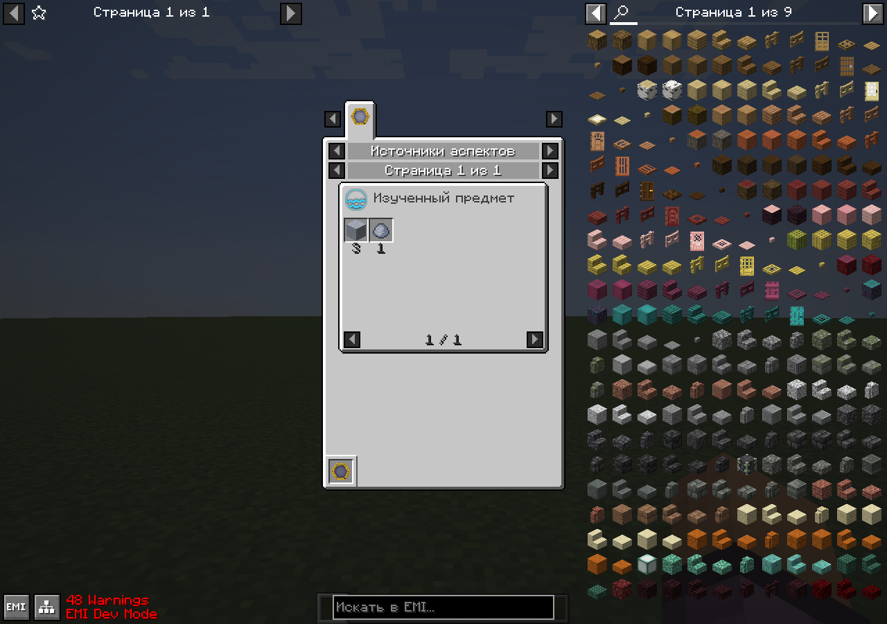
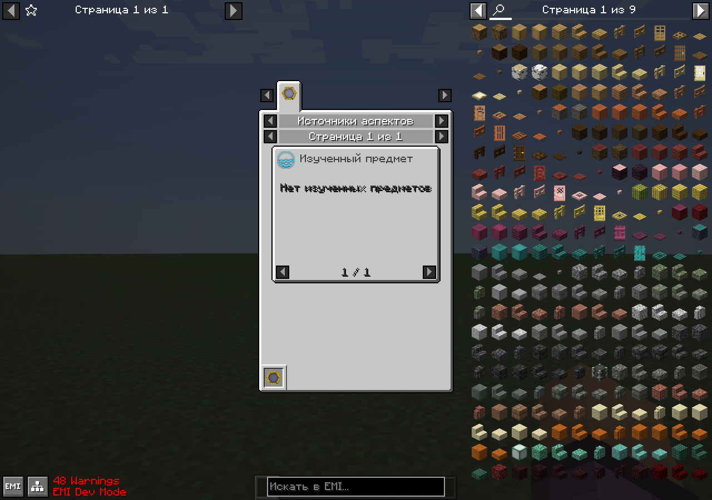
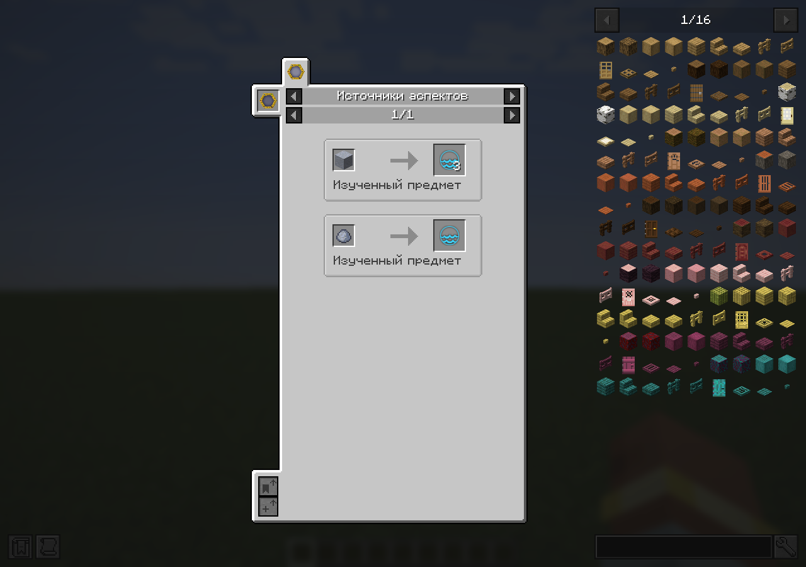

# Scanned aspect sources in EMI and JEI

Selecting an aspect in EMI now opens an **Aspect Sources** category listing the
current character's scanned items that contain it, with the amount per item.
JEI already provides the same lookup through its dynamic recipe-manager plugin.
Both integrations use the canonical object-aspect resolver and normal/advanced
scan knowledge (`@` and `#`), rather than a separate aspect catalogue.

EMI 1.1.22 indexes recipes when it reloads and exposes no dynamic recipe-provider
API. The integration therefore registers one informational page per aspect and
resolves its item slots from current knowledge. Source items are absent from
static recipe inputs; the page does not participate in crafting trees or
craftable-item calculations. Each page shows up to 24 sources, with navigation
for the remaining items. Tooltips and labels show the aspect amount per item.
The reviewed `/aspect_sources/<aspect>` factory is an EMI recipe identifier,
not a file request; the composed-resource inventory records that distinction.

The candidate cache follows the current player, world, EMI ingredient index and
scan set, retaining stack components. The displayed list resolves current aspect
tags at most once per 50 milliseconds per open view; every slot access additionally
checks live scan membership. New scans appear without reloading the plugin, and
forgotten sources disappear from rendering, tooltips and clicks immediately.

The isolated EMI client probe uses a fresh flat world with explicit scan fixtures
supplied through the server API and synchronized through normal knowledge packets.
It queries the actual EMI recipe manager and retains actual native slot widgets
across empty knowledge, ordinary scans, an advanced scan and a knowledge reset.
This is a targeted integration check, not survival acquisition or remote multiplayer.

Verified with Java 21, Minecraft 1.21.1 and Fabric:

- Common JUnit: 2,895 passed, five original-JAR oracle cases skipped, no failures.
- `:fabric:clientTestClasses`, `:fabric:build`, production/test isolation: passed.
- `:fabric:runEmiAspectSourcesClient -PwithEmi`: passed with EMI 1.1.22+1.21.1.
- `:fabric:runJeiAspectSourcesClient -PwithJei`: passed with JEI 19.43.0.398.
- Both actual clients returned no sources with empty knowledge, only clay balls
  after ordinary scans (Aqua 1; scanned dirt excluded), clay blocks after a new
  advanced scan (Aqua 3), and no sources after knowledge reset. The EMI probe also
  checked native slot widgets retained across all four states.
- All five native screenshots were inspected. The EMI empty-state message fits,
  forgotten slots disappear, and quantities are readable in both viewers.
- Resource verifier: zero missing references; all 18 composed-resource tests passed.
- Dedicated Fabric server without either viewer: both focused native checks passed
  (`scanKnowledgeAdvancedMarkersSuppressThaumometer` and
  `scanApiUsesNativeNbtAndNodeLocators`), then the server stopped cleanly.

EMI's development-mode overlay reports 48 untranslated existing aspect-family and
deepslate tag names; the new aspect-source pages produced no recipe warnings.
Pagination beyond 24 sources was reviewed in code but not exercised by these
focused fixtures. NeoForge validation is deferred under the repository's
Fabric-first instructions; no new survival or remote multiplayer acceptance is claimed.

[Exact receipts and artifact hash](../porting/aspect-sources-client.json).

